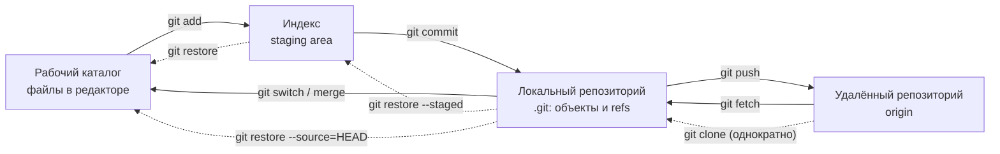
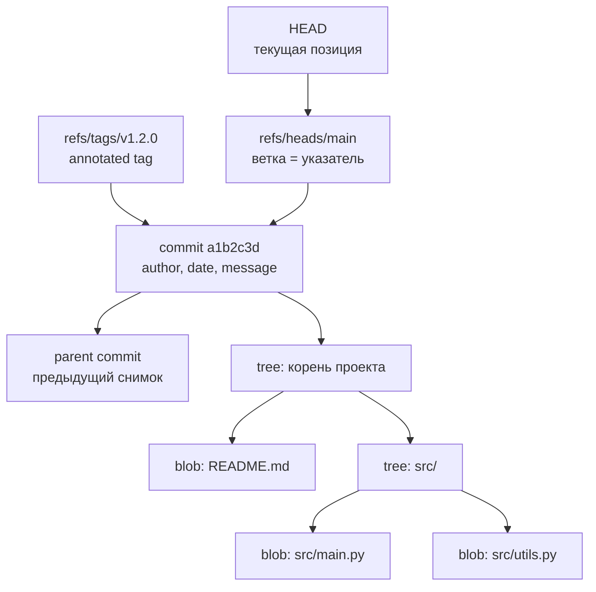
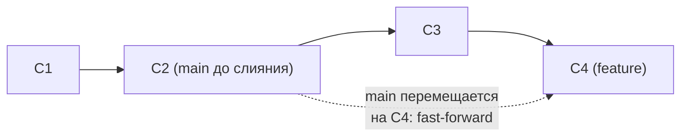
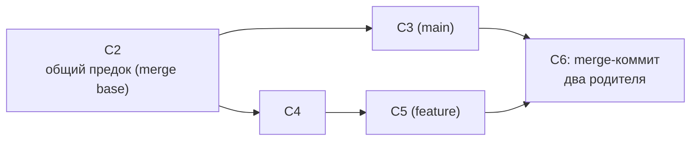
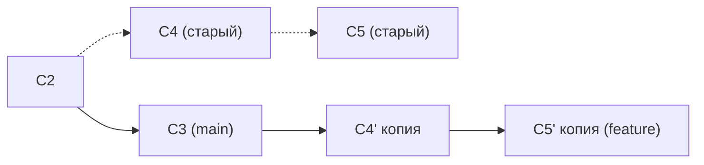
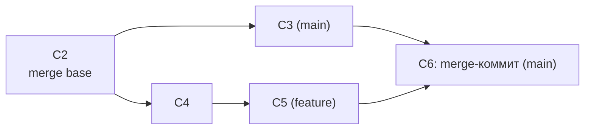
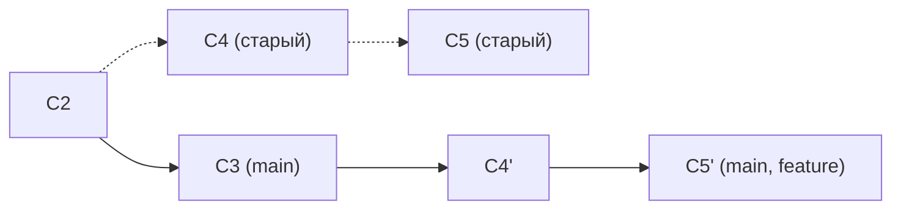
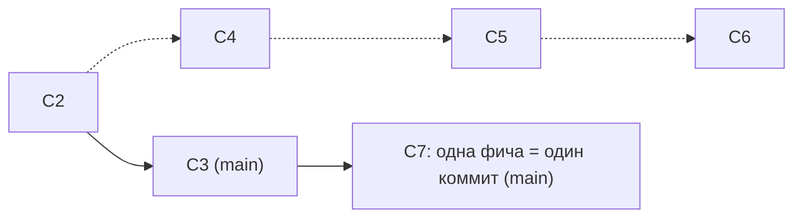
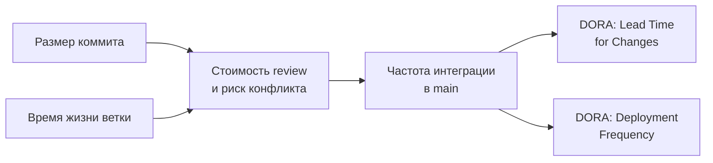

# Git: основы — концепции, объектная модель и ежедневная работа

**Доклад для DevOps-менторства**

---

## Содержание

1. [Введение](#введение)
2. [Что такое Git и зачем контроль версий](#что-такое-git-и-зачем-контроль-версий)
3. [Ключевые понятия: зоны, ссылки и объекты](#ключевые-понятия-зоны-ссылки-и-объекты)
4. [Архитектура: как Git устроен внутри](#архитектура-как-git-устроен-внутри)
5. [Ежедневная работа подробно](#ежедневная-работа-подробно)
6. [Инструменты](#инструменты)
7. [Практические примеры конфигураций](#практические-примеры-конфигураций)
8. [Стратегии интеграции изменений](#стратегии-интеграции-изменений)
9. [Best practices](#best-practices)
10. [Частые ошибки и антипаттерны](#частые-ошибки-и-антипаттерны)
11. [Метрики эффективности](#метрики-эффективности)
12. [Заключение](#заключение)

> Этот мануал — про то, как пользоваться Git самому, каждый день. Командные
> процессы (trunk-based, GitFlow, правила Pull Request, code review) — тема
> отдельного мануала `05-git-workflow-manual.MD` (запланирован в `ROADMAP.MD`),
> который строится ровно на
> том фундаменте, который описан здесь.

---

## Введение

Git — это первый инструмент, который DevOps-инженер открывает утром и последний, который закрывает вечером. Он лежит под всем остальным: пайплайн CI/CD запускается по коммиту, Infrastructure as Code хранится в репозитории, GitOps-подход вообще объявляет Git единственным источником истины о состоянии инфраструктуры. Не понимая Git, вы не сможете нормально работать ни с одним из этих инструментов — только копировать команды из чужих инструкций и надеяться, что сработает.

Отсюда важный вывод: Git нужно понимать *моделью*, а не набором заученных заклинаний. Человек, который знает, что коммит — это снимок дерева файлов, а ветка — просто подвижный указатель на коммит, спокойно разберётся в любой незнакомой ситуации. Человек, который знает только «`git pull`, потом `git push`, а если ругается — клонирую заново», будет терять работу и время.

Без системы контроля версий:
- История изменений живёт в папках `project_final_v2_ПРАВКИ_ok/` и в памяти автора
- Непонятно, кто, когда и **зачем** поменял строку, из-за которой упал прод
- Два человека не могут одновременно править один проект без ручной склейки файлов
- Откат к «версии, которая работала» — это восстановление из бэкапа, если он есть
- Автоматизация невозможна: CI не за что зацепиться, деплоить нечего, кроме архива

С Git:
- Каждое изменение зафиксировано с автором, датой, сообщением и связью с задачей
- Любую версию проекта можно воспроизвести за секунду по её идентификатору
- Параллельная работа — норма: ветки изолируют незаконченные изменения
- Откат — обычная операция (`git revert`), а не аварийная процедура
- Репозиторий становится триггером и источником данных для всей автоматизации: CI/CD, IaC, GitOps

---

## Что такое Git и зачем контроль версий

**Git** — распределённая система контроля версий (DVCS): инструмент, который хранит полную историю изменений проекта в виде последовательности снимков и позволяет каждому участнику работать с полной копией этой истории локально.

Три свойства, которые определяют Git и объясняют почти всё его поведение:

1. **Распределённость.** У каждого разработчика — полноценный репозиторий с историей, а не «рабочая копия». Коммит, ветвление, просмотр истории, откат работают без сети.
2. **Снимки, а не дельты.** Каждый коммит логически хранит полное состояние дерева файлов; неизменившиеся файлы просто переиспользуют существующие объекты. (Физически при упаковке в packfile Git применяет дельта-сжатие — но это деталь реализации, а не модель.)
3. **Адресация по содержимому.** Каждый объект идентифицируется хешем своего содержимого — SHA-1, 40 hex-символов, обычно сокращаемый до 7–8 (`a1b2c3d`). Изменилось содержимое — изменился идентификатор, поэтому историю нельзя подправить незаметно. (Поддержка SHA-256 существует с Git 2.29 как экспериментальная и пока плохо совместима с большинством серверов — в реальных проектах вы почти всегда работаете с SHA-1.)

Термины, которые часто путают:

| Понятие | Расшифровка | Суть |
|---|---|---|
| **VCS** | Version Control System | Система контроля версий — общий класс инструментов, хранящих историю изменений |
| **CVCS** | Centralized VCS | Централизованная модель: история живёт на одном сервере, у клиента только рабочая копия (SVN, CVS, Perforce) |
| **DVCS** | Distributed VCS | Распределённая модель: полная история у каждого участника (Git, Mercurial) |
| **SCM** | Source Code Management | Обиходный синоним VCS, часто встречается в документации CI-систем |
| **Git-хостинг (forge)** | — | Сервис *поверх* Git: веб-интерфейс, Pull Request, issues, CI (GitHub, GitLab, Bitbucket) |

**Git — это не GitHub.** Git — программа на вашей машине и формат хранения истории; GitHub/GitLab/Bitbucket — сервисы, которые хостят удалённые репозитории и добавляют вокруг них командные процессы. Всё, что описано в этом мануале, работает без единого внешнего сервиса — хоть с репозиторием на USB-флешке.

---

## Ключевые понятия: зоны, ссылки и объекты

### Три зоны (и почему их именно три)

Главная причина, по которой новички «не понимают Git», — они видят две сущности (файлы и репозиторий), а их три. Между рабочим каталогом и историей есть промежуточная зона — **индекс**, он же staging area.

```
┌──────────────────────┐   git add    ┌──────────────────────┐  git commit  ┌──────────────────────┐
│  Рабочий каталог     │ ───────────► │  Индекс (staging)    │ ───────────► │  Репозиторий (.git)  │
│  working directory   │              │  что войдёт в коммит │              │  история коммитов    │
│  файлы, которые вы   │ ◄─────────── │  подготовленный      │ ◄─────────── │  неизменяемые        │
│  правите в редакторе │ git restore  │  снимок              │ git restore  │  объекты             │
└──────────────────────┘              └──────────────────────┘   --staged   └──────────────────────┘
                                                                                       │
                                                                             git push  │  git fetch
                                                                                       ▼
                                                                          ┌──────────────────────┐
                                                                          │ Удалённый репозиторий│
                                                                          │ origin               │
                                                                          └──────────────────────┘
```

**Ключевое отличие:** индекс существует, чтобы коммит не был обязан совпадать с состоянием диска. Вы правите пять файлов, но коммитите два — получается атомарный, осмысленный коммит вместо свалки. Именно поэтому `git status` показывает две группы файлов («Changes to be committed» и «Changes not staged for commit»): это две разные зоны, а не два разных мнения Git об одних файлах.

### Ссылки: коммит, HEAD, ветка, тег

| Понятие | Что это на самом деле |
|---|---|
| **Коммит (commit)** | Снимок всего дерева файлов + метаданные: автор, дата, сообщение, ссылка на родительский коммит (или два родителя у merge-коммита) |
| **Ветка (branch)** | Подвижный указатель на один коммит — файл в `.git/refs/heads/`, внутри которого лежит хеш. Создание ветки — это запись 41 байта, поэтому она бесплатна |
| **HEAD** | Указатель на *текущее место работы*: обычно ссылка на ветку (`ref: refs/heads/main`), реже — прямо на коммит |
| **Detached HEAD** | Состояние, когда HEAD указывает на коммит, а не на ветку (после `git checkout <sha>` или `git switch --detach`). Коммиты здесь ни к какой ветке не привязаны и легко теряются |
| **Ref** | Любая именованная ссылка на коммит: `refs/heads/*` (локальные ветки), `refs/tags/*` (теги), `refs/remotes/*` (remote-tracking ветки) |
| **Тег (tag)** | Неподвижная метка на коммите. Lightweight — просто ref; annotated (`git tag -a v1.2.0 -m "..."`) — отдельный объект с автором, датой и сообщением. Для релизов используют annotated |
| **origin** | Имя по умолчанию для удалённого репозитория, из которого клонировали. Просто псевдоним URL, не «главный сервер» |

### Объектная модель на практическом уровне

В `.git/objects` лежат объекты всего четырёх типов, и трёх из них достаточно для понимания:

- **blob** — содержимое файла (без имени и прав, только байты);
- **tree** — каталог: список имён с правами и ссылками на blob'ы и вложенные tree;
- **commit** — ссылка на корневой tree + родители + метаданные;
- **tag** (annotated) — ссылка на объект + подпись и сообщение.

Почему это стоит знать: становится очевидно, что переименование файла — это не «переименование», а новое имя в tree при том же blob (поэтому Git «находит» переименования эвристикой, а не хранит их). Становится понятно, почему пустой каталог нельзя закоммитить — tree хранит файлы, а каталог без файлов не существует. И почему удаление секрета из свежего коммита не удаляет его из репозитория — объект остаётся достижимым из старых коммитов.

Посмотреть своими руками:

```bash
git cat-file -p HEAD          # содержимое коммита: tree, parent, author
git cat-file -p HEAD^{tree}   # корневое дерево: права, тип, хеш, имя
git rev-parse HEAD            # полный хеш текущего коммита
```

---

## Архитектура: как Git устроен внутри

Общая схема ежедневного цикла: как изменение путешествует от редактора до удалённого репозитория и обратно.



Сплошные стрелки — основной путь изменения вперёд; пунктирные — отмена и первичное получение репозитория. Обратите внимание: `git pull` на схеме нет намеренно — это не отдельная зона-переход, а сокращение для `git fetch` + `git merge` (или `git rebase`).

### Схема объектов и ссылок



Из этой схемы читается вся механика Git: переключение ветки — это смена того, куда смотрит HEAD; новый коммит — новый объект, чей parent — предыдущий, а ветка сдвигается на него; «потерять коммит» можно только потеряв все ссылки, ведущие к нему (и даже тогда его на время сохранит reflog).

---

## Ежедневная работа подробно

### 1. Настройка и создание репозитория

Первое, что делается на новой машине — представиться Git: автор коммита берётся из конфига, и исправить это в уже созданных коммитах непросто.

```bash
git config --global user.name "Ivan Petrov"
git config --global user.email "ivan.petrov@example.com"
git config --global init.defaultBranch main
git config --list --show-origin      # откуда взялась каждая настройка
```

Про `init.defaultBranch`: в актуальном Git (2.55) `git init` по-прежнему создаёт ветку **`master`**, если настройка не задана, и печатает подсказку о том, что в Git 3.0 значение по умолчанию сменится на `main`. Поэтому в командах, где принято `main`, настройку задают явно — либо глобально, либо разово: `git init -b main`.

Два способа начать:

```bash
git init my-service            # новый пустой репозиторий
cd my-service

git clone git@github.com:acme/my-service.git       # копия существующего
git clone --depth 1 <url>                          # shallow clone: только последний коммит, для CI
```

`git clone` за один шаг делает четыре вещи: скачивает объекты, создаёт remote `origin`, создаёт локальную ветку по умолчанию с upstream на `origin/<branch>` и раскладывает файлы в рабочий каталог.

Область видимости конфига (от менее приоритетного к более): `--system` → `--global` (`~/.gitconfig`) → `--local` (`.git/config`). Рабочая почта в корпоративном репозитории задаётся именно `--local`.

### 2. Цикл «изменил → добавил → закоммитил»

```bash
git status --short --branch          # что изменилось; -sb компактно
git diff                             # рабочий каталог против индекса
git diff --staged                    # индекс против HEAD — ровно то, что уйдёт в коммит
git add src/payment.py               # добавить файл в индекс
git add -p                           # интерактивно, по кускам (hunk'ам)
git commit -m "fix(payment): retry on 502 from provider"
```

`git add -p` — главный инструмент атомарных коммитов: он позволяет разложить «я тут заодно поправил ещё три вещи» на отдельные осмысленные коммиты.

Правила хорошего сообщения коммита: первая строка — до ~50 символов, в императиве («добавь», «исправь», а не «добавил»), затем пустая строка и тело с ответом на вопрос **зачем** (что сделано, видно из диффа; почему — нет). Если в команде принят Conventional Commits (`feat:`, `fix:`, `chore:`), формат заодно даёт автоматическую генерацию changelog и версии.

```bash
git commit --amend                   # поправить последний коммит (только если он не отправлен!)
git commit --amend --no-edit         # дописать забытый файл, сообщение не менять
```

### 3. Чтение истории

```bash
git log --oneline --graph --decorate --all   # компактный граф всех ветвей
git log -p src/payment.py                    # история конкретного файла с диффами
git log --since="2 weeks ago" --author=Ivan
git show a1b2c3d                             # один коммит целиком
git blame src/payment.py                     # кто и в каком коммите написал каждую строку
git bisect start                             # бинарный поиск коммита, где всё сломалось
```

`git blame` и `git bisect` — причина, по которой стоит писать атомарные коммиты: они отвечают на вопрос «из-за чего это сломалось» за минуты вместо часов, но только если коммиты маленькие и осмысленные.

### 4. Ветвление

Ветка в Git — указатель, поэтому создание и переключение почти бесплатны:

```bash
git branch                            # список локальных ветвей
git switch -c feature/payment-retry   # создать и перейти
git switch main                       # вернуться
git branch -d feature/payment-retry   # удалить слитую ветку (-D — принудительно)
git branch -vv                        # ветки + их upstream + расхождение
```

`git switch` и `git restore` появились в Git 2.23, чтобы разделить две разные функции перегруженного `git checkout` (переключение ветвей и восстановление файлов). Отметки EXPERIMENTAL в документации у них давно нет — это стабильные команды, и учиться стоит сразу на них. `git checkout` при этом никуда не делся и продолжает работать: вы будете встречать его в старых инструкциях и скриптах.

### 5. Слияние: fast-forward и three-way merge

Есть два принципиально разных исхода `git merge`.

**Fast-forward.** Если в целевой ветке не появилось новых коммитов, «слияние» — это просто перенос указателя вперёд. Никакого merge-коммита не создаётся, история линейна.



**Three-way merge.** Если история разошлась — обе ветки получили свои коммиты — Git берёт три точки: общего предка (merge base) и две вершины, и создаёт новый коммит с **двумя родителями**.



Стрелки на схемах — хронологический порядок (внутри Git коммит ссылается на родителя, то есть физически стрелки направлены в прошлое).

Полезные флаги: `git merge --no-ff` заставляет создать merge-коммит даже там, где возможен fast-forward (так видно факт вливания ветки), `git merge --ff-only` — наоборот, отказывается сливать, если нужен merge-коммит.

**Конфликт слияния** возникает, когда обе стороны изменили *одни и те же строки* (или одна изменила, а другая удалила файл). Git не угадывает — он останавливается и оставляет маркеры в файле:

```
<<<<<<< HEAD
    retries = 3
=======
    retries = 5
>>>>>>> main
```

Разрешение конфликта:

```bash
git diff --name-only --diff-filter=U   # список конфликтующих файлов
# правим файл руками: убираем маркеры, оставляем верный код
git add src/payment.py                 # add = "конфликт разрешён"
git commit                             # сообщение merge-коммита уже подготовлено
git merge --abort                      # или: откатиться в состояние до merge
```

Совет по настройке: `git config --global merge.conflictstyle zdiff3` (доступно с Git 2.35; по умолчанию используется стиль `merge`). Стиль `zdiff3` дополнительно показывает в маркерах *исходную* версию из общего предка — без неё часто невозможно понять, какая из двух сторон что именно поменяла.

### 6. Rebase против merge — концептуально

`git rebase main` в ветке `feature` берёт ваши коммиты, **создаёт их копии** поверх вершины `main` и переставляет ветку на них. Исходные коммиты остаются в репозитории до сборки мусора, но история ветки становится линейной, как будто вы начали работу от актуального `main`.



| Критерий | merge | rebase |
|---|---|---|
| История | Сохраняется как было, плюс merge-коммит | Переписывается: новые хеши у коммитов |
| Читаемость `git log` | Ветвления видны, но граф «паутинистый» | Линейная, легко читать и bisect'ить |
| Безопасность | Безопасен всегда | Только для **неопубликованных** коммитов |
| Типичное применение | Влить готовую ветку в `main` | Подтянуть свежий `main` в свою ветку перед PR |

**Золотое правило:** не переписывайте историю, которую уже видели другие. Rebase, `--amend` и squash — для своей локальной или личной ветки; для общей ветки инструмент отмены — `git revert`.

Технические детали, полезные на практике: с Git 2.26 rebase по умолчанию использует «merge»-бэкенд (раньше был «am»), поэтому корректно работает с переименованиями и стратегиями слияния. Флаг `--preserve-merges` удалён в Git 2.34 — актуальный аналог `--rebase-merges`. При конфликте во время rebase: `git rebase --continue`, `--skip` или `--abort`.

Какую из моделей выбирает команда и как это связано с PR-процессом — это уже вопрос командного workflow, см. `05-git-workflow-manual.MD`.

### 7. Работа с удалёнными репозиториями

```bash
git remote -v                                   # список remote'ов и URL
git remote add upstream git@github.com:acme/svc.git   # имя второго remote (форк-схема); это не то же, что upstream-ветка ниже
git fetch origin                                # скачать изменения, НЕ трогая рабочие файлы
git fetch --prune                               # заодно удалить ссылки на удалённые ветки
git pull                                        # fetch + merge/rebase текущей ветки
git push origin feature/payment-retry
git push -u origin feature/payment-retry        # + связать ветку с upstream
```

Ключевое различие: **`fetch` безопасен и неинтерактивен** — он лишь обновляет remote-tracking ссылки (`origin/main`). `pull` дополнительно вливает изменения в вашу рабочую ветку и потому может создать merge-коммит или конфликт. Привычка «сначала `fetch`, посмотреть `git log origin/main`, потом решать» экономит много нервов.

**Remote-tracking ветка** `origin/main` — это локальный слепок того, где была `main` на сервере в момент последнего fetch. Она обновляется только fetch/push, а не сама по себе, поэтому «`origin/main` не двигается» почти всегда означает «я не сделал fetch».

**Upstream (tracking branch)** — связь локальной ветки с ветвью на remote. Она даёт `git status` возможность писать «ahead 2, behind 1» и позволяет писать `git push`/`git pull` без аргументов. Задаётся `git push -u` или `git branch -u origin/main`.

Что важно знать про современное поведение `pull`: если локальная и удалённая ветки **разошлись**, а ни `pull.rebase`, ни `pull.ff` не настроены, Git начиная с версии 2.34 не делает merge молча, а прерывается с ошибкой `fatal: Need to specify how to reconcile divergent branches` (до 2.34 это было предупреждение). Это не поломка, а требование определиться один раз:

```bash
git config --global pull.ff only        # только fast-forward, иначе — руками (безопасный дефолт)
# либо
git config --global pull.rebase true    # подтягивать через rebase
```

Значение по умолчанию у `pull.rebase` — `false`, у `pull.ff` — не задано; поэтому без явной настройки вы и получаете ту самую ошибку. Если fast-forward возможен, `pull` спокойно работает и без всякой настройки.

Про `push --force`: он затирает историю на сервере и может уничтожить коммиты коллег. Безопасная замена — `git push --force-with-lease`: она откажется от записи, если на сервере появилось что-то, чего вы не видели. Если в вашем Git ≥ 2.37 надоедает `-u` при первом push, есть `git config --global push.autoSetupRemote true` (по умолчанию `false`).

### 8. Отмена изменений: restore, reset, revert, reflog

Самая частая паника новичка — «я всё сломал». Почти всё в Git обратимо; нужно лишь выбрать правильный инструмент по тому, *где* находится изменение.

| Что нужно отменить | Команда |
|---|---|
| Правки в файле в рабочем каталоге | `git restore src/app.py` |
| Файл добавлен в индекс, правки нужно оставить | `git restore --staged src/app.py` |
| Последний коммит, ещё не отправленный (дополнить/переписать) | `git commit --amend` |
| Последний коммит, изменения оставить в индексе | `git reset --soft HEAD~1` |
| Последний коммит, изменения оставить в рабочем каталоге | `git reset HEAD~1` (это `--mixed`, режим по умолчанию) |
| Последний коммит и все изменения — безвозвратно | `git reset --hard HEAD~1` (опасно) |
| Уже отправленный (публичный) коммит | `git revert a1b2c3d` — создаёт обратный коммит |
| Уже отправленный merge-коммит | `git revert -m 1 <merge-sha>` |
| Отложить работу, чтобы срочно переключиться | `git stash push -m "wip retry"`, вернуть — `git stash pop` |
| Удалить неотслеживаемые файлы | `git clean -nd` (посмотреть), затем `git clean -fd` |

**Разница между reset и revert принципиальна:** `reset` двигает указатель ветки назад, то есть *переписывает* историю — годится только для локальных коммитов. `revert` добавляет новый коммит, отменяющий изменения — история не страдает, поэтому это единственный корректный способ отката в общей ветке.

**Reflog — страховка от почти любой ошибки.** Git ведёт локальный журнал всех перемещений HEAD и ветвей, включая те коммиты, на которые уже ничего не ссылается:

```bash
git reflog
# a1b2c3d HEAD@{0}: reset: moving to HEAD~1
# 9f8e7d6 HEAD@{1}: commit: fix(payment): retry on 502
git reset --hard 9f8e7d6          # вернуть состояние "до катастрофы"
git switch -c rescue 9f8e7d6      # или аккуратно: вытащить в новую ветку
```

Границы страховки: reflog **локален** (в свежем клоне вашего reflog нет) и не вечен — по умолчанию записи о достижимых коммитах живут 90 дней (`gc.reflogExpire`), о недостижимых — 30 (`gc.reflogExpireUnreachable`), после чего сборка мусора может удалить объекты. И reflog не спасёт то, что никогда не попадало в Git: незакоммиченные правки, снесённые `git reset --hard` или `git clean -fd`, восстановить нельзя. Отсюда практический вывод: `git stash` перед рискованной операцией стоит дешевле, чем героическое восстановление.

### 9. Игнорирование файлов

`.gitignore` описывает, какие пути Git не должен предлагать к добавлению. Что важно понимать:

- Правила действуют **только на неотслеживаемые файлы**. Если файл уже закоммичен, добавление его в `.gitignore` ничего не изменит — нужно `git rm --cached path` и коммит.
- Файл `.gitignore` сам коммитится в репозиторий — это часть проекта. Личные исключения (файлы вашей IDE) лучше держать в `~/.config/git/ignore` (глобально) или `.git/info/exclude` (локально), чтобы не навязывать команде.
- Последнее подходящее правило побеждает, поэтому исключение (`!file`) должно идти **после** правила, которое его игнорирует.
- Отладка: `git check-ignore -v path/to/file` покажет, какая строка какого файла вызвала игнор.

---

## Инструменты

| Категория | Инструменты |
|---|---|
| Базовый CLI и штатные GUI | `git` (CLI), `gitk` (просмотр истории), `git gui` — поставляются вместе с Git |
| TUI-клиенты | lazygit, tig, gitui — быстрые терминальные интерфейсы, отлично подходят для `add -p` и разбора истории |
| Кроссплатформенные GUI | GitKraken (freemium), Sublime Merge (платный), Sourcetree (бесплатный, Windows/macOS), Fork (платный, Windows/macOS), Tower (по подписке, Windows/macOS), GitHub Desktop (бесплатный, Windows/macOS) |
| Интеграция в IDE/редактор | VS Code (встроенный Git + GitLens), JetBrains IDE, vim-fugitive / Neogit, Magit (Emacs) |
| Diff и merge | delta, difftastic (структурный дифф), Meld, KDiff3, Beyond Compare, VS Code как `merge.tool` |
| Хостинг и code review | GitHub, GitLab, Bitbucket, Gitea / Forgejo (self-hosted), Azure DevOps Repos |
| Хуки и гигиена коммитов | pre-commit, husky + lint-staged, commitlint, gitleaks, git-secrets |
| Большие файлы и крупные репозитории | Git LFS, git-annex, Scalar (partial clone, sparse-checkout) |
| Аутентификация и доступ | ssh-agent, Git Credential Manager, osxkeychain helper, `gh` / `glab` CLI |

Практическая рекомендация: изучать Git стоит через CLI (все инструкции, CI-скрипты и ответы в интернете написаны на нём), а GUI/TUI подключать там, где визуализация реально быстрее — интерактивный staging, разбор большого конфликта, чтение запутанного графа ветвей.

---

## Практические примеры конфигураций

### Пример 1: `.gitignore` для типичного проекта DevOps-команды

```gitignore
# --- Зависимости и артефакты сборки ---
node_modules/
dist/
build/
*.egg-info/
__pycache__/
*.py[cod]
.venv/

# --- Логи и временные файлы ---
*.log
npm-debug.log*
tmp/
.cache/

# --- Локальные настройки окружения и секреты ---
.env
.env.*
!.env.example
*.pem
*.key
secrets.yaml

# --- Terraform ---
.terraform/
*.tfstate
*.tfstate.*
crash.log
*.tfvars
!*.tfvars.example

# --- Тестовые отчёты ---
coverage/
.coverage
htmlcov/
junit.xml

# --- IDE и ОС ---
.idea/
.vscode/*
!.vscode/settings.json
!.vscode/extensions.json
.DS_Store
Thumbs.db
```

Обратите внимание на пары «запрет + исключение»: `.env.*` вместе с `!.env.example` даёт возможность хранить в репозитории шаблон переменных, не рискуя закоммитить настоящие значения. Порядок важен — исключение идёт после запрета.

### Пример 2: разумный глобальный `~/.gitconfig`

```ini
[user]
	name = Ivan Petrov
	email = ivan.petrov@example.com

[init]
	defaultBranch = main

[core]
	editor = nvim
	autocrlf = input          ; на Windows: true

[pull]
	ff = only                 ; никаких молчаливых merge-коммитов при pull

[rebase]
	autostash = true          ; сам спрячет и вернёт незакоммиченные правки
	autosquash = true

[merge]
	conflictstyle = zdiff3    ; требуется Git >= 2.35

[diff]
	algorithm = histogram
	colorMoved = zebra

[fetch]
	prune = true              ; чистить ссылки на удалённые ветки

[push]
	default = simple
	autoSetupRemote = true    ; требуется Git >= 2.37

[alias]
	st = status -sb
	lg = log --oneline --graph --decorate --all
	last = log -1 --stat
	unstage = restore --staged
	amend = commit --amend --no-edit
```

Рабочую почту в корпоративных репозиториях удобно переопределять локально: `git config --local user.email ivan.petrov@company.com`.

### Пример 3: `.gitattributes` — переносы строк и бинарные файлы

```gitattributes
# Нормализуем переводы строк в репозитории: в истории всегда LF
* text=auto eol=lf

*.sh   text eol=lf
*.bat  text eol=crlf
*.ps1  text eol=crlf

# Явно бинарные файлы: не диффить и не пытаться нормализовать
*.png  binary
*.jpg  binary
*.pdf  binary
*.tar.gz binary

# Большие бинарники — через Git LFS
*.iso  filter=lfs diff=lfs merge=lfs -text
```

Без этого файла Windows- и Linux-разработчики регулярно порождают коммиты, где «изменился весь файл», хотя менялся только перевод строки.

### Пример 4: разрешение конфликта от начала до конца

```console
$ git switch feature/payment-retry
$ git fetch origin
$ git merge origin/main
Auto-merging src/payment.py
CONFLICT (content): Merge conflict in src/payment.py
Automatic merge failed; fix conflicts and then commit the result.

$ git status --short
UU src/payment.py

$ git diff --name-only --diff-filter=U
src/payment.py

# правим файл: убираем маркеры <<<<<<< ======= >>>>>>>, оставляем верный вариант
$ git add src/payment.py
$ git commit
[feature/payment-retry 7c1d9ab] Merge remote-tracking branch 'origin/main' into feature/payment-retry

# если стало страшно на любом шаге до commit:
$ git merge --abort
```

---

## Стратегии интеграции изменений

Ниже — три способа влить ветку в основную. Это технические паттерны; какой из них закрепить как командное правило (и как это увязать с PR-процессом) — тема мануала `05-git-workflow-manual.MD`.

### Merge-коммит (`git merge --no-ff`)



История сохраняется полностью: видно, какие коммиты входили в ветку и когда она была влита. Цена — «паутинистый» граф в больших проектах. Подходит, когда важна прослеживаемость и когда ветку делали несколько человек.

### Rebase + fast-forward



Коммиты ветки переносятся поверх актуального `main`, история линейна: `git log` читается сверху вниз как последовательность изменений, `git bisect` работает идеально. Цена — переписанные хеши, поэтому это допустимо только для ещё не опубликованных (или личных) веток.

### Squash



Все коммиты ветки сжимаются в один. В `main` попадает чистая история «одна фича — один коммит», а весь черновой шум (`wip`, `fix typo`, `again`) остаётся за кадром. Цена — потеря промежуточных шагов: если внутри ветки было десять осмысленных изменений, отменить точечно одно из них уже не получится.

### Паттерн «синхронизируйся часто»

Независимо от выбранной стратегии работает одно правило: чем дольше ветка живёт в стороне от `main`, тем дороже интеграция — конфликты растут нелинейно от времени расхождения. Практика: каждый рабочий день `git fetch origin` и подтягивание `origin/main` в свою ветку (`merge` или `rebase` — по договорённости команды), а не «сольюсь, когда закончу через две недели».

---

## Best Practices

1. **Атомарные коммиты** — один коммит = одно логическое изменение; такой коммит можно отревьюить за минуту, точечно откатить через `revert` и найти через `bisect`.
2. **Осмысленные сообщения коммитов** — первая строка в императиве до ~50 символов, тело отвечает на «зачем»; через полгода при разборе инцидента история будет вашим единственным источником контекста.
3. **`.gitignore` до первого коммита** — иначе артефакты сборки и локальные конфиги попадут в историю, а вычищать их оттуда придётся переписыванием всей истории.
4. **Секреты не коммитим никогда** — история распределена по всем клонам и CI-раннерам, поэтому попавший в коммит ключ надо считать скомпрометированным и ротировать, а не «удалить коммит».
5. **Проверяйте `git status` и `git diff --staged` перед коммитом** — тридцать секунд проверки экономят часы на чистку случайно закоммиченных файлов.
6. **Короткоживущие ветки и ежедневная синхронизация с `main`** — сложность слияния растёт быстрее, чем линейно, от времени расхождения ветвей.
7. **Не переписывайте опубликованную историю** — `rebase`, `--amend` и squash только на своих ветках; для общих используйте `revert`, а если force всё же нужен — только `--force-with-lease`.
8. **Освойте `reflog`, `stash` и `restore` раньше, чем `reset --hard`** — знание того, что почти всё обратимо, снимает страх и заодно предотвращает необратимые действия «на всякий случай».
9. **Явно настройте `pull.ff` или `pull.rebase`** — иначе `pull` либо остановит вас ошибкой при расхождении ветвей, либо (в старых версиях) незаметно засеет историю merge-коммитами.
10. **Автоматизируйте гигиену через хуки** — pre-commit с линтером и gitleaks ловит секреты и мусор до попадания в историю, когда исправление стоит один `git add`, а не ротацию ключей.
11. **Подписывайте релизные теги и коммиты (GPG/SSH)** — для артефактов, попадающих в прод, важно доказуемое авторство: тег `v1.2.0` становится проверяемой точкой сборки.

---

## Частые ошибки и антипаттерны

| Антипаттерн | Проблема | Решение |
|---|---|---|
| Гигантский коммит «fixed everything» на 40 файлов | Невозможно ни отревьюить, ни откатить частично, `bisect` бесполезен | Разбивать через `git add -p`, коммитить по одному логическому изменению |
| Сообщения `wip`, `fix`, `.` как норма | История не отвечает на вопрос «почему», разбор инцидента превращается в археологию | Шаблон сообщения (`commit.template`), Conventional Commits, commitlint в CI |
| `git add .` не глядя | В историю попадают локальные конфиги, дампы, `.env` с секретами | `git status` перед add, `git add -p`, полноценный `.gitignore` |
| `git push --force` в общую ветку | Затирает коммиты коллег; у всех «разъезжается» история | Только свои ветки и только `--force-with-lease`; в общих — `revert` |
| Ветка живёт три недели «до готовности фичи» | Merge hell: конфликты во множестве файлов, слияние занимает дни | Короткие ветки, ежедневный `fetch` + синхронизация с `main` |
| Секрет закоммичен, «потом удалим коммит» | Ключ уже в клонах, кэшах CI и, возможно, в форках — удаление коммита ничего не отменяет | Немедленная ротация секрета + `gitleaks` в pre-commit и в пайплайне |
| Бинарники и артефакты сборки в Git | Репозиторий распухает, `clone` и CI замедляются навсегда — история неизменяема | Git LFS для больших файлов, артефакты — в registry (см. `02-cicd-manual.MD`) |
| `git reset --hard` как реакция на любую непонятную ситуацию | Незакоммиченные изменения теряются безвозвратно — их не спасёт даже reflog | Сначала `git stash` или `git switch -c backup`, разбираться потом |
| Коммит сгенерированных файлов (`dist/`, `node_modules/`, `*.tfstate`) | Конфликты в каждом слиянии; `tfstate` вообще содержит секреты | `.gitignore` + сборка в CI; state — в remote backend |
| «Клонирую заново, когда Git ругается» | Теряются локальные ветки и незакоммиченная работа; причина проблемы не изучена | Прочитать сообщение Git: оно почти всегда содержит подсказку с нужной командой |
| Работа в detached HEAD без понимания | Новые коммиты не привязаны к ветке и «исчезают» при переключении | Следить за `git status`; чтобы сохранить работу — `git switch -c <branch>` |

---

## Метрики эффективности

У Git нет собственного «стандарта зрелости» вроде DORA, но есть измеримые признаки здоровой работы с репозиторием — и они напрямую влияют на [DORA-метрики](../glossary/GLOSSARY.MD) из `02-cicd-manual.MD`:

1. **Средний размер коммита** (строк/файлов на коммит) — большие коммиты означают дорогой review и невозможность точечного отката.
2. **Время жизни ветки** (от создания до слияния) — главный предиктор конфликтов; здоровая цель для фичи-ветки — дни, не недели.
3. **Частота интеграции в `main`** — сколько раз в день изменения попадают в основную ветку; прямой вход в Lead Time for Changes.
4. **Доля слияний с конфликтами** — растёт при долгих ветках и «размазанных» по кодовой базе изменениях.
5. **Доля коммитов, связанных с задачей** (номер тикета в сообщении) — определяет, можно ли восстановить контекст изменения через год.
6. **Частота `revert`/hotfix-коммитов** — косвенный индикатор качества проверок перед слиянием.
7. **Размер репозитория и время `clone`** — растущие значения обычно означают закоммиченные бинарники; замедляют каждый запуск CI.
8. **Число находок секретов сканером** (gitleaks и аналоги) — целевое значение ноль, и метрика должна проверяться в пайплайне, а не раз в год.



---

## Заключение

Git даёт команде три вещи, без которых современная разработка невозможна: полную прослеживаемость изменений, возможность безопасно работать параллельно и надёжную точку отката. Всё это работает не благодаря заученным командам, а благодаря простой модели: объекты, адресуемые по содержимому, и подвижные указатели на них.

С чего начать на практике: настройте `~/.gitconfig` (имя, почта, `init.defaultBranch`, `pull.ff`), создайте тренировочный репозиторий и осознанно проделайте в нём полный цикл — коммит, ветка, конфликт слияния, `revert`, восстановление коммита через `reflog`. Ключевой навык здесь не «знать команды», а спокойно отвечать на вопрос «в каком состоянии сейчас репозиторий»: `git status`, `git log --oneline --graph --all` и `git branch -vv` дают этот ответ почти всегда.

Когда ежедневный цикл станет автоматическим, переходите к `05-git-workflow-manual.MD` — командные стратегии ветвления и PR-процесс имеют смысл только на этом фундаменте.

---
