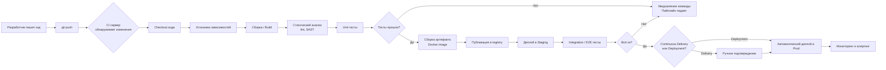
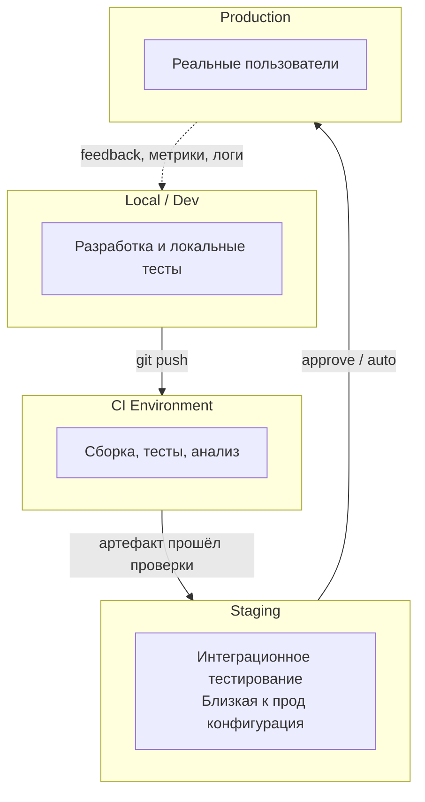
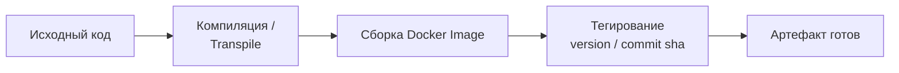
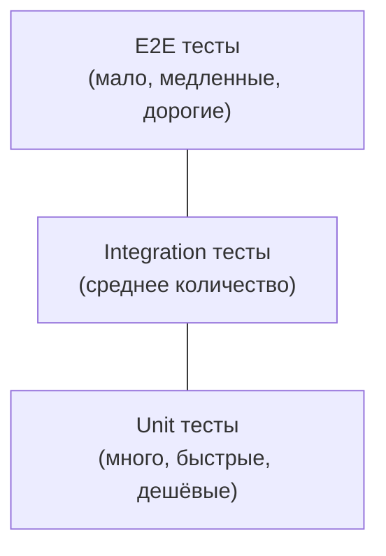
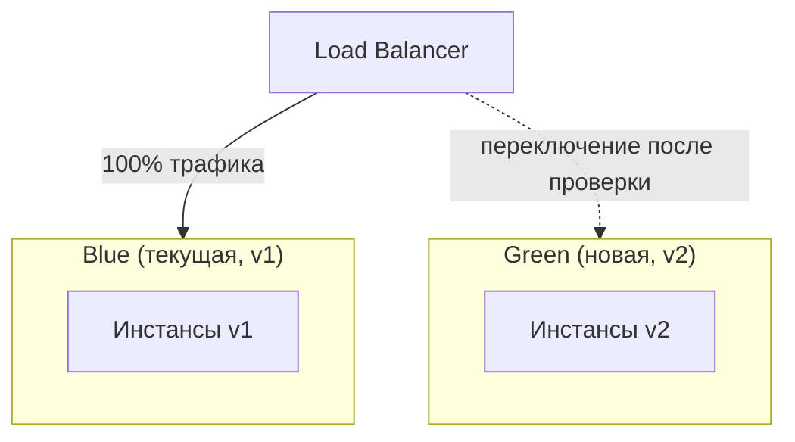
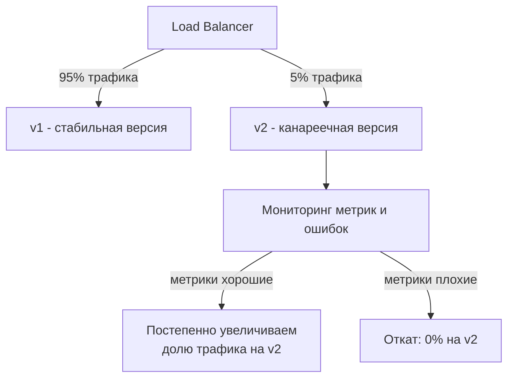
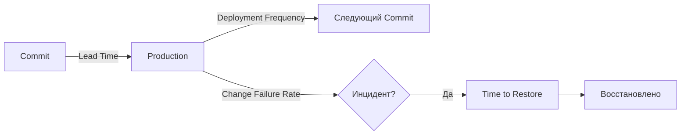

# CI/CD: Непрерывная интеграция и доставка

**Доклад для DevOps-менторства**

---

## Содержание

1. [Введение](#введение)
2. [Что такое CI/CD](#что-такое-cicd)
3. [CI vs CD vs Continuous Deployment](#ci-vs-cd-vs-continuous-deployment)
4. [Архитектура CI/CD пайплайна](#архитектура-cicd-пайплайна)
5. [Этапы пайплайна подробно](#этапы-пайплайна-подробно)
6. [Инструменты](#инструменты)
7. [Практические примеры конфигураций](#практические-примеры-конфигураций)
8. [Стратегии деплоя](#стратегии-деплоя)
9. [Best practices](#best-practices)
10. [Частые ошибки и антипаттерны](#частые-ошибки-и-антипаттерны)
11. [Метрики эффективности](#метрики-эффективности)
12. [Заключение](#заключение)

---

## Введение

CI/CD — один из краеугольных камней современной DevOps-культуры. Это набор практик и инструментов, которые позволяют командам разработки быстро, безопасно и предсказуемо доставлять код от коммита до продакшена.

Без CI/CD:
- Интеграция кода происходит редко и болезненно ("merge hell")
- Тестирование выполняется вручную и нерегулярно
- Деплой — это стрессовое событие, часто по ночам или выходным
- Откат изменений занимает часы

С CI/CD:
- Каждый коммит автоматически проверяется
- Обратная связь приходит за минуты, а не дни
- Деплой становится рутинной, скучной (в хорошем смысле) операцией
- Откаты быстрые и предсказуемые

---

## Что такое CI/CD

**CI/CD** расшифровывается как:

| Аббревиатура | Расшифровка | Суть |
|---|---|---|
| **CI** | Continuous Integration (непрерывная интеграция) | Частое слияние изменений в основную ветку с автоматической проверкой |
| **CD** | Continuous Delivery (непрерывная доставка) | Автоматическая подготовка релиза, готового к деплою в любой момент |
| **CD** | Continuous Deployment (непрерывное развёртывание) | Автоматический деплой каждого прошедшего проверки изменения в прод |

---

## CI vs CD vs Continuous Deployment

```
┌─────────────────────────────────────────────────────────────────┐
│                    Continuous Integration (CI)                   │
│  Commit → Build → Unit Tests → Static Analysis                   │
└─────────────────────────────────────────────────────────────────┘
                              │
                              ▼
┌─────────────────────────────────────────────────────────────────┐
│                 Continuous Delivery (CD)                         │
│  ...→ Integration Tests → Staging → Ручное подтверждение         │
└─────────────────────────────────────────────────────────────────┘
                              │
                              ▼ (при Continuous Deployment - автоматически)
┌─────────────────────────────────────────────────────────────────┐
│                Continuous Deployment                             │
│  ...→ Автоматический деплой в Production                         │
└─────────────────────────────────────────────────────────────────┘
```

**Ключевое отличие:** Continuous Delivery всегда оставляет финальное решение "деплоить или нет" за человеком. Continuous Deployment убирает эту точку принятия решения — если все тесты прошли, код автоматически уезжает в прод.

---

## Архитектура CI/CD пайплайна

Общая mermaid-диаграмма классического пайплайна:



### Схема окружений (environments)



---

## Этапы пайплайна подробно

### 1. Source (Триггер)
Пайплайн запускается по событию: `push`, `pull_request`, `tag`, по расписанию (`cron`) или вручную.

### 2. Build (Сборка)
Компиляция кода, сборка Docker-образа, установка зависимостей. Цель — получить воспроизводимый артефакт.



### 3. Test (Тестирование)
Многоуровневая пирамида тестирования — фундамент качества CI:



- **Unit-тесты** — проверяют отдельные функции/модули, выполняются секунды.
- **Integration-тесты** — проверяют взаимодействие компонентов (БД, API).
- **E2E-тесты** — проверяют весь флоу глазами пользователя, самые медленные.

### 4. Code Quality & Security
- **Linting** (ESLint, Pylint, golangci-lint)
- **SAST** (статический анализ безопасности: SonarQube, Semgrep)
- **Dependency scanning** (Snyk, Dependabot, Trivy) — поиск уязвимостей в зависимостях
- **Secrets scanning** — поиск случайно закоммиченных ключей/паролей

### 5. Package / Artifact
Сборка финального артефакта: Docker-образ, `.jar`, `.zip`, npm-пакет — и публикация в реестр (Docker Hub, ECR, Nexus, Artifactory).

### 6. Deploy
Развёртывание в целевое окружение с использованием одной из стратегий деплоя (см. ниже).

### 7. Monitor & Feedback
После деплоя система мониторинга (Prometheus, Grafana, Datadog) отслеживает метрики, а алертинг уведомляет о проблемах — это замыкает цикл обратной связи.

---

## Инструменты

| Категория | Инструменты |
|---|---|
| CI/CD платформы | GitHub Actions, GitLab CI/CD, Jenkins, CircleCI, Argo CD, TeamCity |
| Контейнеризация | Docker, Podman |
| Оркестрация | Kubernetes, Docker Swarm |
| IaC | Terraform, Ansible, Pulumi |
| Реестры артефактов | Docker Hub, Amazon ECR, GitLab Registry, Nexus |
| Мониторинг | Prometheus, Grafana, Datadog, ELK Stack |
| Управление секретами | HashiCorp Vault, AWS Secrets Manager, SOPS |

---

## Практические примеры конфигураций

### Пример 1: GitHub Actions

```yaml
name: CI/CD Pipeline

on:
  push:
    branches: [main]
  pull_request:
    branches: [main]

jobs:
  build-and-test:
    runs-on: ubuntu-latest
    steps:
      - name: Checkout code
        uses: actions/checkout@v4

      - name: Setup Node.js
        uses: actions/setup-node@v4
        with:
          node-version: '20'

      - name: Install dependencies
        run: npm ci

      - name: Lint
        run: npm run lint

      - name: Run unit tests
        run: npm test -- --coverage

      - name: Build Docker image
        run: docker build -t myapp:${{ github.sha }} .

  deploy:
    needs: build-and-test
    if: github.ref == 'refs/heads/main'
    runs-on: ubuntu-latest
    steps:
      - name: Deploy to staging
        run: ./scripts/deploy.sh staging

      - name: Run smoke tests
        run: ./scripts/smoke-test.sh

      - name: Deploy to production
        if: success()
        run: ./scripts/deploy.sh production
```

### Пример 2: GitLab CI/CD

```yaml
stages:
  - build
  - test
  - package
  - deploy

variables:
  DOCKER_IMAGE: registry.example.com/myapp

build:
  stage: build
  script:
    - docker build -t $DOCKER_IMAGE:$CI_COMMIT_SHA .

unit-tests:
  stage: test
  script:
    - npm ci
    - npm run test:unit

security-scan:
  stage: test
  script:
    - trivy image $DOCKER_IMAGE:$CI_COMMIT_SHA

push-image:
  stage: package
  script:
    - docker push $DOCKER_IMAGE:$CI_COMMIT_SHA

deploy-staging:
  stage: deploy
  script:
    - kubectl set image deployment/myapp myapp=$DOCKER_IMAGE:$CI_COMMIT_SHA -n staging
  environment:
    name: staging

deploy-production:
  stage: deploy
  script:
    - kubectl set image deployment/myapp myapp=$DOCKER_IMAGE:$CI_COMMIT_SHA -n production
  environment:
    name: production
  when: manual
  only:
    - main
```

### Пример 3: Простой Dockerfile для CI-сборки

```dockerfile
FROM node:20-alpine AS build
WORKDIR /app
COPY package*.json ./
RUN npm ci --only=production
COPY . .
RUN npm run build

FROM node:20-alpine
WORKDIR /app
COPY --from=build /app/dist ./dist
COPY --from=build /app/node_modules ./node_modules
EXPOSE 3000
CMD ["node", "dist/main.js"]
```

---

## Стратегии деплоя

### Rolling Update (постепенное обновление)

```mermaid
flowchart LR
    subgraph "До"
        A1[v1] --> A2[v1] --> A3[v1] --> A4[v1]
    end
    subgraph "Процесс"
        B1[v2] --> B2[v1] --> B3[v1] --> B4[v1]
    end
    subgraph "После"
        C1[v2] --> C2[v2] --> C3[v2] --> C4[v2]
    end
    "До" --> "Процесс" --> "После"
```
Инстансы обновляются поочерёдно, без простоя, но временно сосуществуют две версии.

### Blue-Green Deployment


Разворачиваем полностью новое окружение (Green), тестируем, затем переключаем весь трафик разом. Откат — мгновенное переключение обратно.

### Canary Deployment


Новая версия получает малую долю трафика, и, если метрики в норме, доля постепенно растёт до 100%.

---

## Best Practices

1. **Коммитьте часто, маленькими порциями** — уменьшает риск конфликтов и упрощает откат.
2. **Держите пайплайн быстрым** — если CI выполняется дольше 10-15 минут, разработчики начинают его игнорировать. Параллелизируйте job'ы.
3. **Fail fast** — самые быстрые и дешёвые проверки (lint, unit-тесты) должны идти первыми.
4. **Идентичность окружений** — staging должен максимально соответствовать production (принцип "12-factor app").
5. **Immutable artifacts** — собирайте артефакт один раз и переиспользуйте его на всех этапах, не пересобирайте для каждого окружения.
6. **Секреты не в коде** — используйте vault-системы, никогда не коммитьте ключи и пароли.
7. **Автоматические откаты (rollback)** — пайплайн должен уметь откатываться так же легко, как деплоить.
8. **Инфраструктура как код (IaC)** — окружения должны быть воспроизводимы через Terraform/Ansible, а не настраиваться руками.
9. **Мониторинг после деплоя** — деплой не заканчивается на "выкатили", а на "убедились, что всё работает".
10. **Feature flags** — отделяйте деплой кода от включения фичи для пользователей.

---

## Частые ошибки и антипаттерны

| Антипаттерн | Проблема | Решение |
|---|---|---|
| Долгий монолитный пайплайн (1 job на всё) | Медленная обратная связь | Разбивать на параллельные stages |
| Тесты, которые "иногда падают" (flaky tests) | Команда перестаёт доверять CI | Чинить или удалять нестабильные тесты |
| Ручные шаги внутри "автоматического" пайплайна | Теряется смысл автоматизации | Автоматизировать всё, включая rollback |
| Сборка разных артефактов для staging и prod | Риск "работает у меня, не работает в проде" | Один immutable-артефакт для всех сред |
| Отсутствие мониторинга после релиза | Проблемы обнаруживаются пользователями, а не системой | Алертинг + дашборды сразу после деплоя |
| Хранение секретов в переменных репозитория без шифрования | Утечка данных | Vault / Secrets Manager |

---

## Метрики эффективности

DevOps Research and Assessment (DORA) выделяет 4 ключевые метрики для оценки зрелости CI/CD:

1. **Deployment Frequency** — как часто вы деплоите в прод (цель: несколько раз в день у elite-команд)
2. **Lead Time for Changes** — время от коммита до продакшена
3. **Change Failure Rate** — процент деплоев, вызывающих инцидент
4. **Time to Restore Service** — как быстро восстанавливаетесь после сбоя



---

## Заключение

CI/CD — это не просто набор инструментов, а культурный и технический фундамент, который позволяет командам:

- Снижать риски за счёт частых маленьких изменений вместо редких больших релизов
- Получать быструю обратную связь о качестве кода
- Делать деплой рутинной, а не пугающей операцией
- Быстро восстанавливаться после сбоев

Внедрение CI/CD — это путь, а не разовое действие: начинайте с автоматизации сборки и тестов (CI), постепенно добавляйте автоматический деплой в staging, и только когда команда набирается уверенности — переходите к Continuous Deployment в production.

---
