# CI/CD: Непрерывная интеграция и доставка

**Доклад для DevOps-менторства**

---

## Содержание

1. [Введение](#введение)
2. [Что такое CI/CD](#что-такое-cicd)
3. [CI vs CD vs Continuous Deployment](#ci-vs-cd-vs-continuous-deployment)
4. [Архитектура CI/CD пайплайна](#архитектура-cicd-пайплайна)
5. [Этапы пайплайна подробно](#этапы-пайплайна-подробно)
6. [Инструменты](#инструменты)
7. [Практические примеры конфигураций](#практические-примеры-конфигураций)
8. [Стратегии деплоя](#стратегии-деплоя)
9. [Best practices](#best-practices)
10. [Частые ошибки и антипаттерны](#частые-ошибки-и-антипаттерны)
11. [Метрики эффективности](#метрики-эффективности)
12. [Заключение](#заключение)

---

## Введение

CI/CD — один из краеугольных камней современной DevOps-культуры. Это набор практик и инструментов, которые позволяют командам разработки быстро, безопасно и предсказуемо доставлять код от коммита до продакшена.

Без CI/CD:
- Интеграция кода происходит редко и болезненно ("merge hell")
- Тестирование выполняется вручную и нерегулярно
- Деплой — это стрессовое событие, часто по ночам или выходным
- Откат изменений занимает часы

С CI/CD:
- Каждый коммит автоматически проверяется
- Обратная связь приходит за минуты, а не дни
- Деплой становится рутинной, скучной (в хорошем смысле) операцией
- Откаты быстрые и предсказуемые

> **См. также.** CI/CD стоит на двух соседних мануалах курса:
> [00-git-manual](00-git-manual.MD) — что именно триггерит пайплайн (ветки,
> теги, pull request'ы, атомарные коммиты), и
> [03-docker-manual](03-docker-manual.MD) — как собирается тот самый
> неизменяемый артефакт, который пайплайн катит по окружениям.

---

## Что такое CI/CD

**CI/CD** расшифровывается как:

| Аббревиатура | Расшифровка | Суть |
|---|---|---|
| **CI** | Continuous Integration (непрерывная интеграция) | Частое слияние изменений в основную ветку с автоматической проверкой |
| **CD** | Continuous Delivery (непрерывная доставка) | Автоматическая подготовка релиза, готового к деплою в любой момент |
| **CD** | Continuous Deployment (непрерывное развёртывание) | Автоматический деплой каждого прошедшего проверки изменения в прод |

---

## CI vs CD vs Continuous Deployment

Три термина часто рисуют как три стадии подряд, и это главный источник
путаницы. На самом деле CI — фундамент, на котором стоят обе CD, а
Continuous Delivery и Continuous Deployment — **не последовательные этапы,
а два взаимоисключающих режима работы одного и того же пайплайна**:
разница только в том, есть ли перед production ручные ворота.

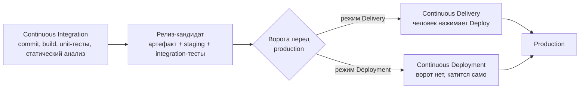

| | Continuous Delivery | Continuous Deployment |
|---|---|---|
| **Кто решает деплоить** | Человек (релиз-менеджер, тимлид, дежурный) | Никто — решает зелёный пайплайн |
| **Что является воротами** | Ручной approval в окружении production | Ворот нет: последний тест и есть ворота |
| **Что автоматизировано** | Всё до кнопки «Deploy» включительно | Всё, включая сам деплой |
| **Частота релизов** | Ограничена готовностью людей нажать кнопку | Ограничена только частотой merge в main |
| **Где применимо** | Регулируемые домены, релизы «по расписанию», незрелое тестирование | Продукты с высоким покрытием тестами и хорошей наблюдаемостью |

**Ключевое отличие:** Continuous Delivery всегда оставляет финальное решение "деплоить или нет" за человеком. Continuous Deployment убирает эту точку принятия решения — если все тесты прошли, код автоматически уезжает в прод.

### Что нужно, чтобы вообще перейти к Continuous Deployment

Continuous Deployment — не «включить галочку», а следствие зрелости.
Пока не выполнены эти условия, автодеплой просто быстрее доставляет
пользователям баги:

1. **Доверенное покрытие тестами** — не процент покрытия сам по себе, а
   уверенность, что зелёный пайплайн действительно означает работающий
   продукт; регрессии должны ловиться автоматически, а не на staging глазами.
2. **Feature flags** — деплой кода отделён от включения фичи, иначе
   «выкатить в любой момент» невозможно для незаконченной функциональности.
3. **Наблюдаемость (observability)** — метрики, логи и алерты, по которым
   деградация видна за минуты после выката, а не по тикету от поддержки.
4. **Автоматический откат** — сбой должен откатываться без сбора людей в
   переговорке; иначе цена ошибки съедает всю выгоду от скорости.
5. **Совместимость соседних версий** — миграции БД и API совместимы
   «вперёд и назад», иначе откат кода не откатывает инцидент.

---

## Архитектура CI/CD пайплайна

Пайплайн удобно смотреть в два приёма: сначала путь «коммит → артефакт в
реестре» (зона ответственности CI), затем «артефакт → production и обратная
связь» (зона ответственности CD).

**Часть 1. CI: от коммита до неизменяемого артефакта**

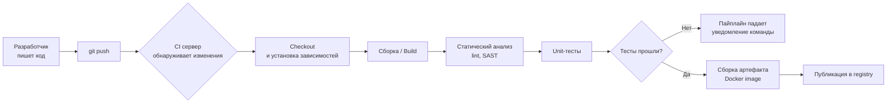

**Часть 2. CD: от артефакта до production и обратной связи**

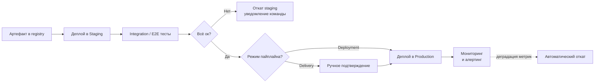

Обратите внимание: в реестр попадает **один** артефакт, и дальше по всем
окружениям едет именно он — это и есть принцип immutable artifacts из
раздела best practices.

### Схема окружений (environments)

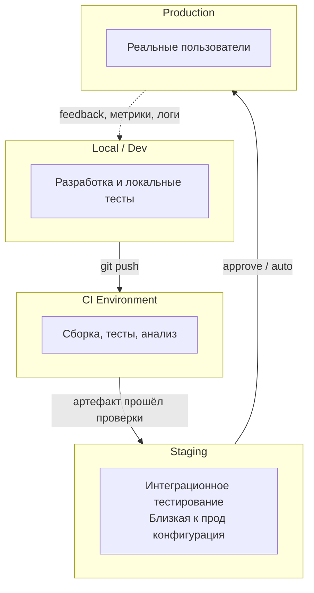

---

## Этапы пайплайна подробно

### 1. Source (Триггер)
Пайплайн запускается по событию: `push`, `pull_request`, `tag`, по расписанию (`cron`) или вручную.

### 2. Build (Сборка)
Компиляция кода, сборка Docker-образа, установка зависимостей. Цель — получить воспроизводимый артефакт.

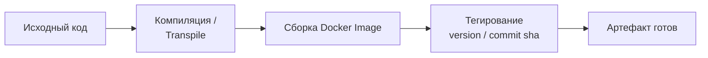

### 3. Test (Тестирование)
Многоуровневая пирамида тестирования — фундамент качества CI:

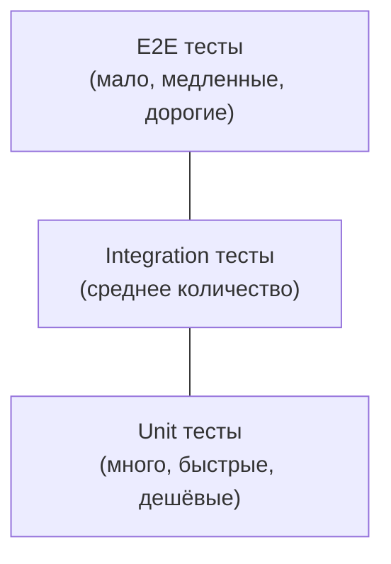

- **Unit-тесты** — проверяют отдельные функции/модули, выполняются секунды.
- **Integration-тесты** — проверяют взаимодействие компонентов (БД, API).
- **E2E-тесты** — проверяют весь флоу глазами пользователя, самые медленные.

### 4. Code Quality & Security
- **Linting** (ESLint, Pylint, golangci-lint)
- **SAST** (статический анализ безопасности: SonarQube, Semgrep)
- **Dependency scanning** (Snyk, Dependabot, Trivy) — поиск уязвимостей в зависимостях
- **Secrets scanning** — поиск случайно закоммиченных ключей/паролей

### 5. Package / Artifact
Сборка финального артефакта: Docker-образ, `.jar`, `.zip`, npm-пакет — и публикация в реестр (Docker Hub, ECR, Nexus, Artifactory).

### 6. Deploy
Развёртывание в целевое окружение с использованием одной из стратегий деплоя (см. ниже).

### 7. Monitor & Feedback
После деплоя система мониторинга (Prometheus, Grafana, Datadog) отслеживает метрики, а алертинг уведомляет о проблемах — это замыкает цикл обратной связи.

### Сквозные механики: кэш, параллелизм, окружения, безопасность

Следующие четыре темы — не отдельные этапы, а свойства пайплайна в целом.
Именно они превращают формально работающий пайплайн в тот, которым команда
реально пользуется.

#### Кэширование

Пайплайн стартует на чистом раннере: без кэша каждый запуск заново качает
весь `node_modules` или заново собирает все слои образа. Различают два вида
кэша, и путать их не надо:

- **Кэш зависимостей** — сохранение каталога пакетного менеджера
  (`~/.npm`, `~/.m2`, `~/.cache/pip`) между запусками. Ключ кэша строится по
  хешу lock-файла: `package-lock.json` не менялся — кэш валиден.
- **Кэш слоёв сборки образа** — переиспользование неизменившихся слоёв
  Docker-образа (`cache-from`/`cache-to` в buildx). Работает только если
  инструкции в Dockerfile упорядочены от редко меняющихся к часто
  меняющимся; подробнее — в [мануале по Docker](03-docker-manual.MD#2-кэш-сборки-и-порядок-инструкций).

```yaml
# GitHub Actions: кэш зависимостей встроен в setup-node
- uses: actions/setup-node@v4
  with:
    node-version: '24'
    cache: 'npm'          # кэширует ~/.npm по хешу package-lock.json
```

Главное правило кэша: он должен **ускорять, но не влиять на результат**.
Кэш, из-за которого сборка проходит на устаревших зависимостях, — это уже
не оптимизация, а источник плавающих багов. Поэтому кэшируют загруженные
пакеты, а не результат установки, и всегда ставят зависимости строго по
lock-файлу (`npm ci`, а не `npm install`).

#### Матричные сборки и параллелизм

Матрица запускает один и тот же job в нескольких вариантах одновременно —
это основной способ проверять несколько версий рантайма или ОС, не
удлиняя пайплайн:

```yaml
jobs:
  test:
    runs-on: ${{ matrix.os }}
    strategy:
      fail-fast: false          # не гасить остальные варианты из-за одного упавшего
      matrix:
        os: [ubuntu-latest, macos-latest]
        node-version: ['22', '24']
    steps:
      - uses: actions/checkout@v4
      - uses: actions/setup-node@v4
        with:
          node-version: ${{ matrix.node-version }}
          cache: 'npm'
      - run: npm ci && npm test
```

Второй вид параллелизма — разбиение по типу проверок: lint, unit-тесты и
сборка образа не зависят друг от друга и должны быть отдельными job'ами,
а не шагами одного длинного job'а. Это прямое лекарство от антипаттерна
«монолитный пайплайн»: разработчик узнаёт об ошибке линтера через минуту,
а не через двадцать.

#### Окружения и подтверждения (approvals)

Окружение (environment) в CI-платформе — это именованная цель деплоя со
своими секретами и правилами защиты. Именно механизм защиты окружения, а
не что-то в коде пайплайна, технически отделяет Continuous Delivery от
Continuous Deployment:

- **Required reviewers** — job с `environment: production` встаёт на паузу
  и не начнёт выполняться, пока указанные люди не нажмут Approve.
- **Wait timer** — принудительная задержка перед выкатом (окно, чтобы
  заметить проблему на staging).
- **Deployment branch policy** — деплоить в production разрешено только с
  `main` или с тега, даже если кто-то запустит пайплайн вручную с ветки.
- **Секреты уровня окружения** — прод-креды физически недоступны job'ам,
  которые не объявили `environment: production`.

Практический вывод: не пишите свои «ворота» на скриптах и переменных —
используйте окружения платформы, потому что только они дают аудит (кто и
когда одобрил выкат) и изоляцию секретов.

#### Базовая безопасность пайплайна

CI-раннер имеет доступ к коду, секретам и продакшену — это привлекательная
цель. Минимальный набор гигиены:

- **Минимальные права токена.** Объявляйте `permissions:` явно и по
  умолчанию `contents: read`, расширяя точечно в тех job'ах, где нужно
  писать.
- **OIDC вместо долгоживущих ключей.** Раннер получает
  короткоживущий токен от облака под конкретный workflow, вместо того
  чтобы хранить в секретах вечный `AWS_SECRET_ACCESS_KEY`, который никто
  не ротирует.
- **Пиннинг сторонних Actions по SHA.** Тег `@v4` — подвижная ссылка:
  автор (или тот, кто угнал его аккаунт) может переписать её на вредоносный
  код. `uses: owner/action@<полный-sha>` фиксирует ровно тот код, который
  вы проверяли.
- **Осторожность с триггером `pull_request_target`** — он выполняется в
  контексте базового репозитория с доступом к секретам, поэтому запускать
  на нём код из чужого форка нельзя.

Про безопасность самих собираемых образов (SBOM, provenance, подпись
cosign, блокирующее сканирование по digest) — см. [мануал по
Docker](03-docker-manual.MD#практические-примеры-конфигураций), здесь не
дублируем.

---

## Инструменты

| Категория | Инструменты |
|---|---|
| CI/CD платформы | GitHub Actions, GitLab CI/CD, Jenkins, CircleCI, TeamCity, Woodpecker CI |
| GitOps / доставка в Kubernetes | Argo CD, Flux CD |
| Контейнеризация | Docker, Podman |
| Оркестрация | Kubernetes, Docker Swarm |
| IaC | Terraform, OpenTofu, Ansible, Pulumi |
| Реестры артефактов | Docker Hub, Amazon ECR, GitLab Registry, Harbor, Nexus |
| Мониторинг | Prometheus, Grafana, Datadog, ELK Stack |
| Управление секретами | HashiCorp Vault, AWS Secrets Manager, SOPS |

### Отдельно про GitOps: push- и pull-модель доставки

Argo CD и Flux намеренно вынесены в отдельную строку: это **не** CI-платформы,
они не собирают код и не гоняют тесты. Они решают только последнюю задачу —
довести уже собранный артефакт до кластера, и делают это принципиально
иначе, чем GitHub Actions или GitLab CI.

- **Push-модель (классический CD).** Job в CI сам ходит в кластер:
  `kubectl set image ...`. Значит, у CI-раннера должны лежать креды с правом
  менять production, и фактическое состояние кластера может разъехаться с
  тем, что записано в репозитории (кто-то поправил вручную — никто не узнал).
- **Pull-модель (GitOps).** В кластере живёт агент (Argo CD / Flux),
  который сам следит за Git-репозиторием с манифестами и **подтягивает**
  изменения. Git становится единственным источником истины о желаемом
  состоянии, а агент непрерывно сверяет с ним фактическое состояние
  (reconciliation) и чинит расхождения (drift).

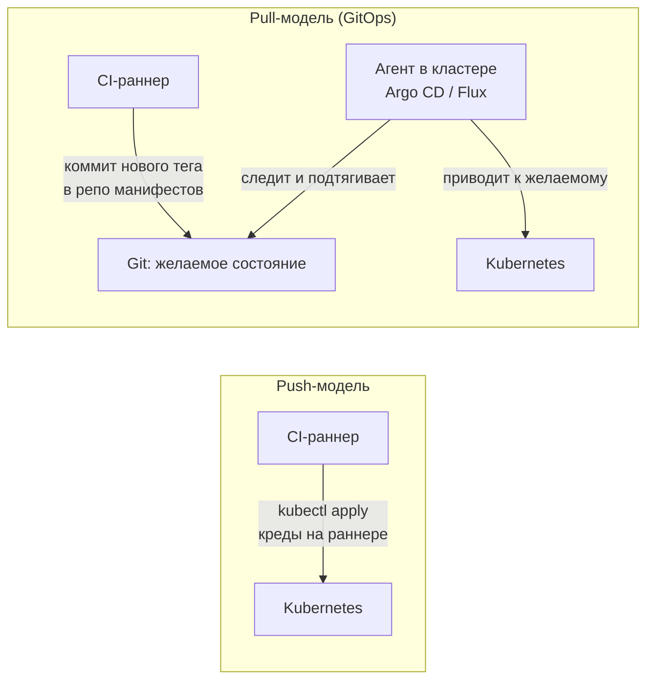

Практическая выгода pull-модели: наружу кластера не выдаются права на
запись, любой выкат — это обычный коммит (значит, есть review и история), а
откат — это `git revert`. Плата — ещё один компонент в кластере и
разделение на два репозитория (код и манифесты), что для маленькой команды
может быть избыточно.

---

## Практические примеры конфигураций

### Пример 1: GitHub Actions

Пайплайн разбит на четыре job'а: проверки → публикация образа в реестр →
staging → production за ручными воротами. Ключевая идея — образ собирается
**один раз**, а дальше по окружениям едет один и тот же тег, привязанный к
SHA коммита.

```yaml
name: CI/CD Pipeline

on:
  push:
    branches: [main]
  pull_request:
    branches: [main]

env:
  # GHCR принимает только имена в нижнем регистре: если owner или repo
  # содержат заглавные буквы, push упадёт — приводите имя к lowercase
  # (отдельным шагом или через готовый action) вместо прямой подстановки
  IMAGE: ghcr.io/${{ github.repository }}

# по умолчанию токену доступно только чтение кода;
# отдельные job'ы расширяют права точечно
permissions:
  contents: read

jobs:
  test:
    runs-on: ubuntu-latest
    steps:
      - uses: actions/checkout@v4

      - uses: actions/setup-node@v4
        with:
          node-version: '24'
          cache: 'npm'

      - run: npm ci
      - run: npm run lint
      - run: npm test -- --coverage

  package:
    # образ публикуем только с main: PR-сборки ничего не пушат в реестр
    needs: test
    if: github.ref == 'refs/heads/main'
    runs-on: ubuntu-latest
    permissions:
      contents: read
      packages: write
    steps:
      - uses: actions/checkout@v4

      - uses: docker/setup-buildx-action@v3

      - uses: docker/login-action@v3
        with:
          registry: ghcr.io
          username: ${{ github.actor }}
          password: ${{ secrets.GITHUB_TOKEN }}

      - name: Build and push
        uses: docker/build-push-action@v6
        with:
          context: .
          push: true
          tags: ${{ env.IMAGE }}:${{ github.sha }}
          cache-from: type=gha
          cache-to: type=gha,mode=max

  deploy-staging:
    needs: package
    runs-on: ubuntu-latest
    environment:
      name: staging
      url: https://staging.example.com
    steps:
      - uses: actions/checkout@v4

      - name: Deploy to staging
        run: ./scripts/deploy.sh staging "${IMAGE}:${GITHUB_SHA}"

      # smoke-тест: минимальная проверка «сервис поднялся и отвечает»,
      # а не полный набор E2E — он должен занимать секунды
      - name: Run smoke tests
        run: ./scripts/smoke-test.sh https://staging.example.com

  deploy-production:
    needs: deploy-staging
    runs-on: ubuntu-latest
    # окружение production защищено required reviewers:
    # job встанет на паузу и дождётся одобрения человека
    environment:
      name: production
      url: https://example.com
    steps:
      - uses: actions/checkout@v4

      - name: Deploy to production
        run: ./scripts/deploy.sh production "${IMAGE}:${GITHUB_SHA}"

      - name: Run smoke tests
        run: ./scripts/smoke-test.sh https://example.com
```

Обратите внимание на три момента:

1. `deploy-*` job'ы начинаются с `actions/checkout` — без него на раннере
   нет ни `scripts/deploy.sh`, ни манифестов; раннер каждый раз чистый.
2. Артефакт передаётся между job'ами через **реестр**, а не «как-то сам»:
   job'ы выполняются на разных машинах и ничего не наследуют друг от друга.
3. Ручные ворота — это `environment: production` с настроенными required
   reviewers в настройках репозитория, а не шаг в YAML. Убрать эти ворота —
   и тот же самый пайплайн превращается из Continuous Delivery в Continuous
   Deployment.

Если деплой ходит в облако, вместо долгоживущих ключей стоит взять OIDC:

```yaml
  # Фрагмент, а не самостоятельный job: показаны только отличия от
  # deploy-production выше. Остальное (runs-on, environment, шаги деплоя
  # и smoke-тестов) остаётся прежним, шаг с OIDC встаёт первым в steps.
  deploy-production:
    permissions:
      contents: read
      id-token: write        # разрешает раннеру запросить OIDC-токен
    steps:
      - uses: aws-actions/configure-aws-credentials@v4
        with:
          role-to-assume: arn:aws:iam::123456789012:role/deploy-prod
          aws-region: eu-central-1
```

### Пример 2: GitLab CI/CD

Здесь важен тот же принцип, но с поправкой на устройство GitLab-раннеров:
каждый job поднимается в **своём** контейнере со своим Docker-демоном.
Образ, собранный в одном job'е, в следующем job'е просто не существует —
поэтому сборка и публикация делаются в одном job'е, а сканирование
подтягивает образ уже из реестра.

```yaml
stages:
  - test
  - package
  - scan
  - deploy

variables:
  # $CI_REGISTRY_IMAGE — адрес реестра проекта, подставляется GitLab автоматически
  IMAGE: $CI_REGISTRY_IMAGE:$CI_COMMIT_SHA

unit-tests:
  stage: test
  image: node:24-alpine
  cache:
    key:
      files: [package-lock.json]
    paths: [.npm/]
  script:
    - npm ci --cache .npm --prefer-offline
    - npm run lint
    - npm run test:unit

build-and-push:
  stage: package
  image: docker:27
  services:
    - docker:27-dind
  variables:
    DOCKER_TLS_CERTDIR: "/certs"
  before_script:
    - docker login -u "$CI_REGISTRY_USER" -p "$CI_REGISTRY_PASSWORD" "$CI_REGISTRY"
  script:
    - docker build -t "$IMAGE" .
    - docker push "$IMAGE"
  rules:
    - if: $CI_COMMIT_BRANCH == "main"

security-scan:
  stage: scan
  needs: [build-and-push]
  image:
    name: aquasec/trivy:latest
    entrypoint: [""]
  before_script:
    # реестр проекта приватный: без учётных данных Trivy не вытянет
    # даже манифест образа и job упадёт на "unauthorized"
    - export TRIVY_USERNAME="$CI_REGISTRY_USER"
    - export TRIVY_PASSWORD="$CI_REGISTRY_PASSWORD"
  script:
    # образ уже в реестре — сканируем именно то, что поедет в прод
    - trivy image --exit-code 1 --severity HIGH,CRITICAL "$IMAGE"
  rules:
    - if: $CI_COMMIT_BRANCH == "main"

deploy-staging:
  stage: deploy
  # версия kubectl зафиксирована: :latest молча меняет клиент под ногами
  image: alpine/kubectl:1.35.3
  script:
    - kubectl set image deployment/myapp myapp="$IMAGE" -n staging
    - kubectl rollout status deployment/myapp -n staging --timeout=120s
  environment:
    name: staging
    url: https://staging.example.com
  rules:
    - if: $CI_COMMIT_BRANCH == "main"

deploy-production:
  stage: deploy
  image: alpine/kubectl:1.35.3
  needs: [deploy-staging]
  script:
    - kubectl set image deployment/myapp myapp="$IMAGE" -n production
    - kubectl rollout status deployment/myapp -n production --timeout=300s
  environment:
    name: production
    url: https://example.com
  rules:
    - if: $CI_COMMIT_BRANCH == "main"
      when: manual
```

Пара деталей, на которых обычно спотыкаются:

- `only:`/`except:` устарели — GitLab рекомендует `rules:`, они мощнее
  (условия по переменным, `when`, `allow_failure` в одном месте).
- `when: manual` внутри `rules:` — это и есть ручные ворота перед
  production; вместе с защищённым окружением `production` только у людей с
  нужными правами появится кнопка запуска.
- `docker:dind` нужен, чтобы внутри job'а вообще был Docker-демон. Если
  политика безопасности запрещает privileged-раннеры, вместо dind берут
  сборщик без демона (Buildah, buildkit-раннер).
- `rollout status` обязателен: без него job зеленеет сразу после отправки
  манифеста, ещё до того, как поды реально поднялись.
- Образ с `kubectl` выбирайте живой и с фиксированной версией. Привычный
  `bitnami/kubectl` больше не подходит: в августе 2025 Bitnami увёл
  бесплатный каталог в `bitnamilegacy/` и перестал его обновлять. Заодно
  учтите, что официального образа `kubectl` в `registry.k8s.io` нет — там
  публикуются только серверные компоненты, — поэтому берут community-образ
  (`alpine/kubectl`, `dtzar/helm-kubectl`) или ставят бинарник сами. Для
  GitLab CI образу обязательно нужна оболочка: distroless-образ без shell
  раннер использовать как `image:` не сможет.

### Пример 3: Простой Dockerfile для CI-сборки

```dockerfile
FROM node:24-alpine AS build
WORKDIR /app
COPY package*.json ./
# ставим ВСЕ зависимости: без devDependencies нечем собирать
RUN npm ci
COPY . .
RUN npm run build
# и только после сборки выкидываем dev-зависимости из node_modules
RUN npm prune --omit=dev

FROM node:24-alpine
ENV NODE_ENV=production
WORKDIR /app
COPY --from=build --chown=node:node /app/dist ./dist
COPY --from=build --chown=node:node /app/node_modules ./node_modules
# package.json нужен и в рантайме: без него Node не увидит "type": "module"
# и ESM-импорты в dist/ не разрешатся
COPY --from=build --chown=node:node /app/package.json ./
# в официальном образе node уже есть непривилегированный пользователь node
USER node
EXPOSE 3000
CMD ["node", "dist/main.js"]
```

Две типичные ошибки, которых здесь нет: установка зависимостей с
`--omit=dev` (или устаревшим `--only=production`) **до** `npm run build` —
тогда сборка падает, потому что компилятора и бандлера в образе нет; и
запуск приложения от root в финальной стадии.

Более продвинутый вариант этого же Dockerfile — с BuildKit-кэшем,
healthcheck и корректной обработкой сигналов — разобран в
[мануале по Docker](03-docker-manual.MD#практические-примеры-конфигураций).

---

## Стратегии деплоя

### Rolling Update (постепенное обновление)

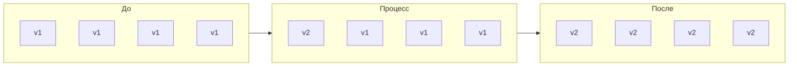
Инстансы обновляются поочерёдно, без простоя, но временно сосуществуют две версии. Инстансы внутри группы независимы и обслуживают трафик параллельно — стрелки между группами показывают только смену состояния во времени.

Практическое следствие сосуществования версий: новая версия обязана быть
совместима со старой по API и схеме БД, иначе часть запросов во время
выката будет падать.

### Blue-Green Deployment

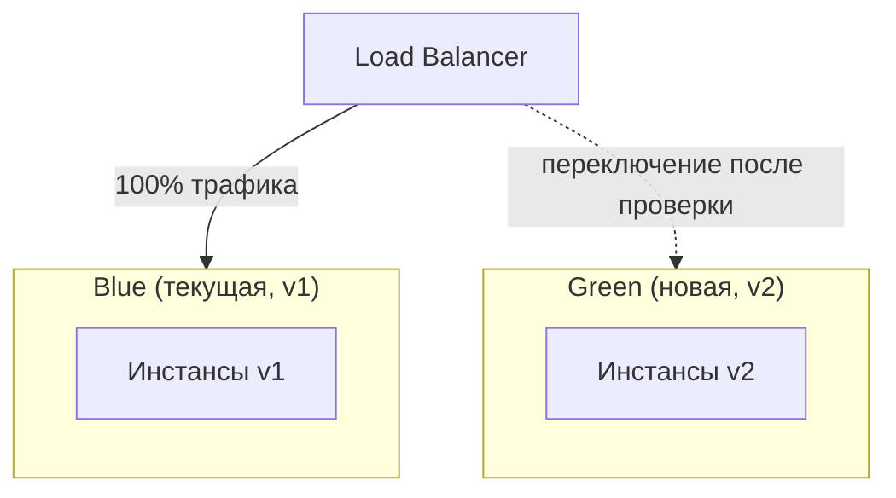
Разворачиваем полностью новое окружение (Green), тестируем, затем переключаем весь трафик разом. Откат — мгновенное переключение обратно.

### Canary Deployment

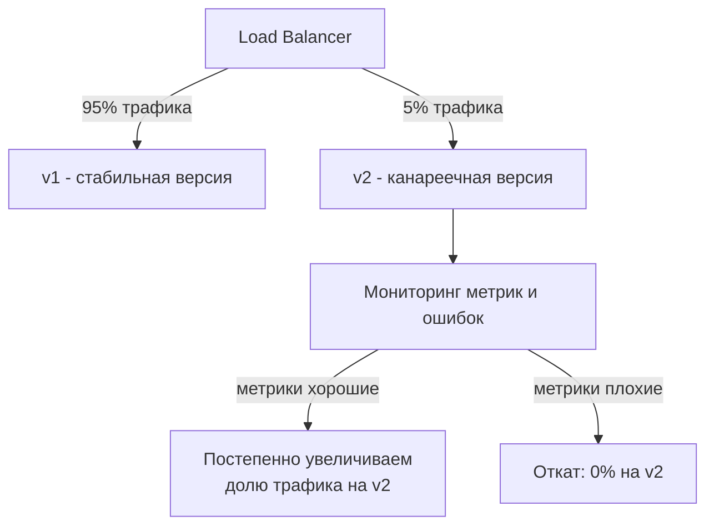
Новая версия получает малую долю трафика, и, если метрики в норме, доля постепенно растёт до 100%.

### Откат (rollback)

Откат — это не «отдельная героическая процедура», а обычный деплой, просто
предыдущей версии. Отсюда главное требование: артефакт предыдущей версии
должен существовать и быть доступен — то есть теги в реестре не
перезаписываются и не удаляются автоматически.

Самый быстрый вариант в Kubernetes — вернуться на предыдущую ревизию
Deployment:

```bash
# посмотреть историю выкатов
kubectl rollout history deployment/myapp -n production

# откатиться на предыдущую ревизию
kubectl rollout undo deployment/myapp -n production

# дождаться и убедиться, что откат реально завершился
kubectl rollout status deployment/myapp -n production --timeout=300s
```

Более предсказуемый (и потому предпочтительный в пайплайне) вариант —
явно выкатить конкретный известный хороший тег, не полагаясь на то, какой
была «предыдущая ревизия»:

```bash
# Источник истины о «последней хорошей» версии — сам кластер, а не git:
# git rev-parse HEAD~1 вернёт предыдущий коммит, который мог вообще
# не доезжать до production. Поэтому образ читаем из живого Deployment
# ДО выката новой версии и сохраняем (артефакт job'а, переменная
# окружения, запись в релиз-трекере).
LAST_GOOD_IMAGE=$(kubectl get deployment/myapp -n production \
  -o jsonpath='{.spec.template.spec.containers[0].image}')

# ... выкатили новую версию, поймали деградацию, откатываемся ...

kubectl set image deployment/myapp myapp="$LAST_GOOD_IMAGE" -n production
kubectl rollout status deployment/myapp -n production --timeout=300s
```

Автоматизировать откат стоит по сигналу мониторинга: если после выката
доля 5xx или p99-латентность выходит за порог в течение N минут — пайплайн
(или прогрессивный деплой-контроллер вроде Argo Rollouts / Flagger)
запускает откат сам, не дожидаясь человека. При Blue-Green откат
сводится к переключению балансировщика обратно на Blue, при Canary — к
обнулению доли трафика на канарейку.

Отдельно держите в голове, что **миграции БД не откатываются командой
rollback**. Поэтому миграции делают обратно совместимыми и выкатывают
отдельным шагом до деплоя кода: сначала «расширить схему», потом код,
и только через релиз-другой — «сузить».

---

## Best Practices

1. **Коммитьте часто, маленькими порциями** — уменьшает риск конфликтов и упрощает откат.
2. **Держите пайплайн быстрым** — если CI выполняется дольше 10-15 минут, разработчики начинают его игнорировать. Параллелизируйте job'ы.
3. **Fail fast** — самые быстрые и дешёвые проверки (lint, unit-тесты) должны идти первыми.
4. **Идентичность окружений** — staging должен максимально соответствовать production; это фактор X методологии "12-factor app" (dev/prod parity): чем меньше расхождение между средами по версиям, конфигурации и зависимостям, тем меньше багов, которые «воспроизводятся только в проде».
5. **Immutable artifacts** — собирайте артефакт один раз и переиспользуйте его на всех этапах, не пересобирайте для каждого окружения.
6. **Секреты не в коде** — используйте vault-системы, никогда не коммитьте ключи и пароли.
7. **Автоматические откаты (rollback)** — пайплайн должен уметь откатываться так же легко, как деплоить.
8. **Инфраструктура как код (IaC)** — окружения должны быть воспроизводимы через Terraform/Ansible, а не настраиваться руками.
9. **Мониторинг после деплоя** — деплой не заканчивается на "выкатили", а на "убедились, что всё работает".
10. **Feature flags** — отделяйте деплой кода от включения фичи для пользователей.

---

## Частые ошибки и антипаттерны

| Антипаттерн | Проблема | Решение |
|---|---|---|
| Долгий монолитный пайплайн (1 job на всё) | Медленная обратная связь | Разбивать на параллельные stages |
| Тесты, которые "иногда падают" (flaky tests) | Команда перестаёт доверять CI | Чинить или удалять нестабильные тесты |
| Ручные шаги внутри "автоматического" пайплайна | Теряется смысл автоматизации | Автоматизировать всё, включая rollback |
| Сборка разных артефактов для staging и prod | Риск "работает у меня, не работает в проде" | Один immutable-артефакт для всех сред |
| Отсутствие мониторинга после релиза | Проблемы обнаруживаются пользователями, а не системой | Алертинг + дашборды сразу после деплоя |
| Хранение секретов в переменных репозитория без шифрования | Утечка данных | Vault / Secrets Manager |

---

## Метрики эффективности

### DORA-метрики

DevOps Research and Assessment (DORA) выделяет 4 ключевые метрики для оценки зрелости доставки:

1. **Deployment Frequency** — как часто вы деплоите в прод
2. **Lead Time for Changes** — время от коммита до продакшена
3. **Change Failure Rate** — доля деплоев, вызывающих инцидент
4. **Failed Deployment Recovery Time** (ранее Time to Restore Service) — как быстро восстанавливаетесь после неудачного выката

Первые две измеряют скорость, вторые две — стабильность, и ценность DORA
именно в том, что смотреть на них надо парами: разгон скорости ценой роста
Change Failure Rate — это не улучшение.

**Про «elite-команды».** Долгие годы DORA раскладывала команды по четырём
уровням (Elite / High / Medium / Low), и в интернете до сих пор гуляют
ориентиры вида «elite деплоит по несколько раз в день». Держите в голове,
что эта модель — не константа: в последних отчётах DORA отошла от простой
четырёхуровневой лестницы к более дробной модели профилей команд, потому
что одни и те же цифры означают очень разное в разных контекстах.
Практический вывод для менторства: не гонитесь за чужим уровнем,
отслеживайте **тренд своих четырёх метрик** и сверяйтесь с актуальным
отчётом DORA, а не с цифрами из статьи трёхлетней давности.

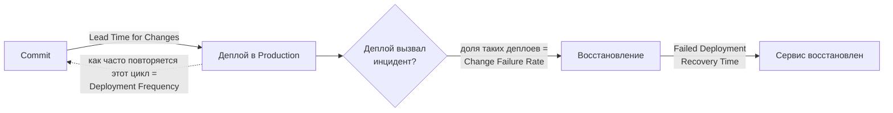

### Метрики здоровья самого пайплайна

DORA измеряет результат доставки, но ничего не говорит о том, удобно ли
командой пользоваться пайплайном. Best practice «держите пайплайн быстрее
10-15 минут» бессмысленна, пока время выполнения никто не измеряет:

| Метрика | Что показывает | Разумный ориентир |
|---|---|---|
| Длительность пайплайна на PR, p50/p95 | Насколько быстро приходит обратная связь к разработчику | p95 < 15 минут |
| Success rate на `main` | Стабильность основной ветки; хронически красный main блокирует всех | > 95% |
| Flaky-test rate | Доля тестов, дающих разный результат без изменений кода — прямой убийца доверия к CI | < 1%, тренд к нулю |
| Queue time (ожидание раннера) | Хватает ли ёмкости раннеров; входит в время ожидания, но не видна в длительности job'а | < 30 секунд |
| Cache hit rate | Работает ли кэш зависимостей и слоёв, или каждый запуск качает всё заново | > 80% |
| Доля ручных перезапусков job'ов | Косвенный индикатор нестабильности: если пайплайн регулярно «чинится» кнопкой Retry, он не автоматизирован | близка к нулю |

Смотреть на них надо так же, как на DORA: важен тренд, а не абсолютное
значение в конкретный день.

---

## Заключение

CI/CD — это не просто набор инструментов, а культурный и технический фундамент, который позволяет командам:

- Снижать риски за счёт частых маленьких изменений вместо редких больших релизов
- Получать быструю обратную связь о качестве кода
- Делать деплой рутинной, а не пугающей операцией
- Быстро восстанавливаться после сбоев

Внедрение CI/CD — это путь, а не разовое действие: начинайте с автоматизации сборки и тестов (CI), постепенно добавляйте автоматический деплой в staging, и только когда команда набирается уверенности — переходите к Continuous Deployment в production.

---
