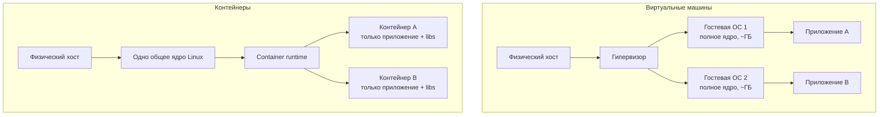
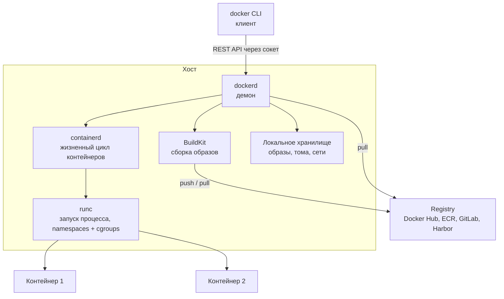
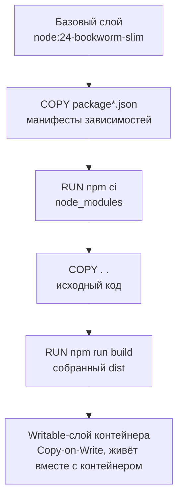
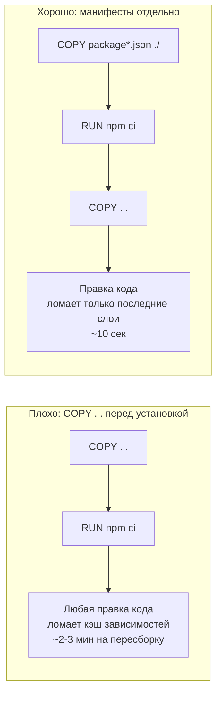
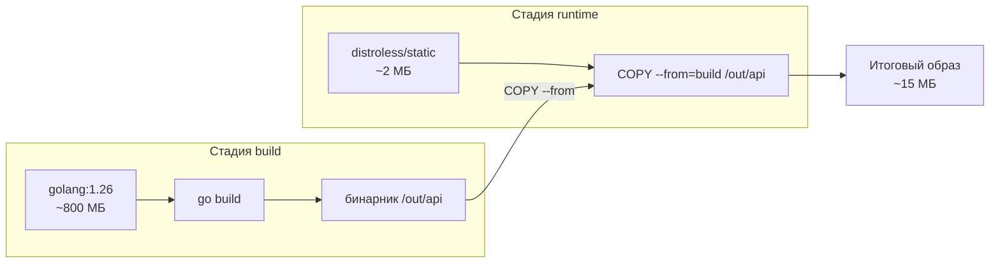
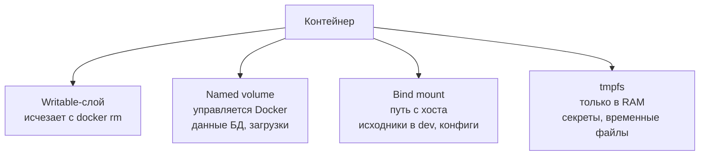
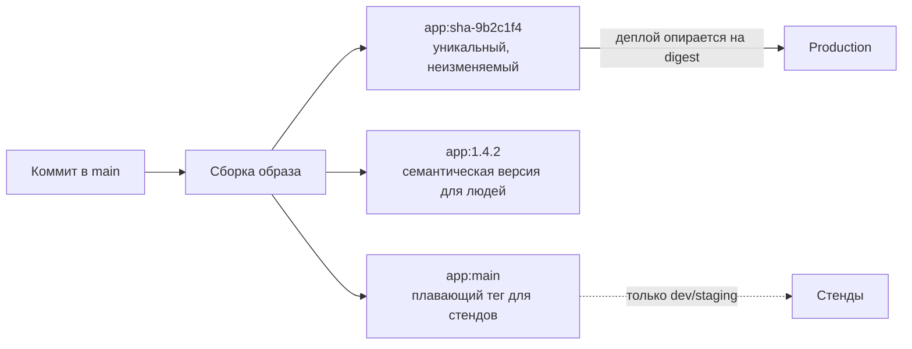
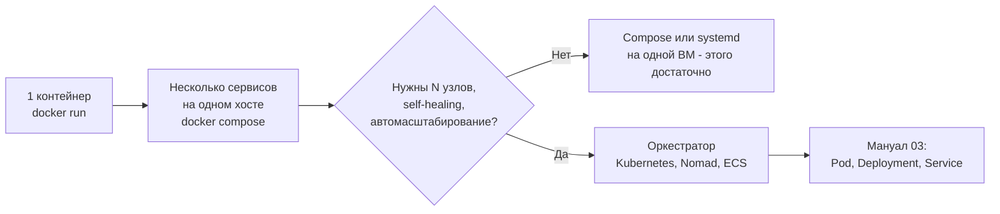
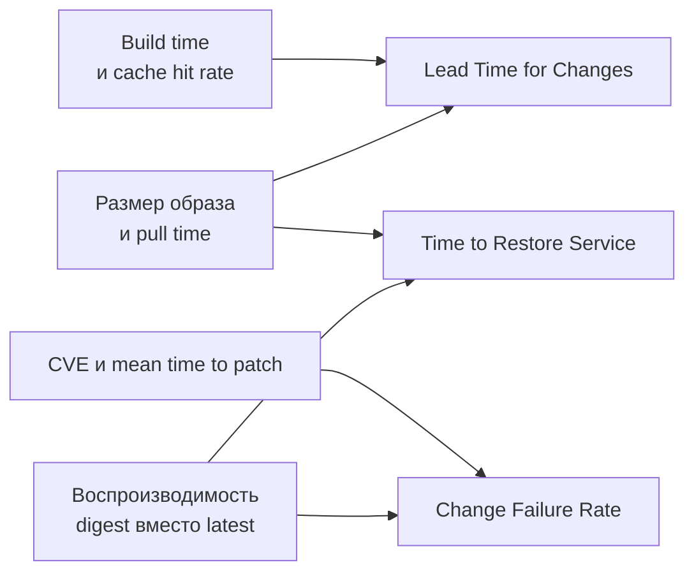

# Docker и контейнеризация: одинаковое окружение везде

**Доклад для DevOps-менторства**

---

## Содержание

1. [Введение](#введение)
2. [Что такое контейнеризация](#что-такое-контейнеризация)
3. [Контейнеры vs виртуальные машины](#контейнеры-vs-виртуальные-машины)
4. [Архитектура Docker](#архитектура-docker)
5. [Компоненты подробно](#компоненты-подробно)
6. [Инструменты](#инструменты)
7. [Практические примеры конфигураций](#практические-примеры-конфигураций)
8. [Стратегии и паттерны](#стратегии-и-паттерны)
9. [Best practices](#best-practices)
10. [Частые ошибки и антипаттерны](#частые-ошибки-и-антипаттерны)
11. [Метрики эффективности](#метрики-эффективности)
12. [Заключение](#заключение)

---

## Введение

В [мануале по CI/CD](01-cicd-manual.MD) мы договорились, что пайплайн собирает
артефакт один раз и катит его во все окружения без пересборки (принцип
Immutable Artifact). Docker — это самый распространённый способ сделать такой
артефакт реальностью: он упаковывает приложение вместе с его зависимостями,
системными библиотеками и конфигурацией в один неизменяемый образ.

Без контейнеров:
- «У меня на ноутбуке работает» — классический спор разработчика и админа,
  потому что версии Python/Node/glibc на машинах разные
- Настройка нового сервера — это многостраничная инструкция в Confluence,
  которая устарела ещё до того, как её дочитали
- Два сервиса на одном хосте конфликтуют за версии системных пакетов
- Онбординг нового разработчика занимает день-два только на подъём окружения

С контейнерами:
- Окружение описано кодом (`Dockerfile`) и лежит в том же репозитории, что и код
- Один и тот же образ проходит через CI, staging и production — байт в байт
- Сервисы изолированы друг от друга и от хоста, при этом стартуют за секунды
- Локальный запуск всего стека — это `docker compose up`, а не полдня настройки

Важно сразу задать рамку: Docker решает задачу **упаковки и запуска** одного
или нескольких контейнеров на одной машине. Задачи «как раскатить это на 40
серверов, пережить падение узла и автоматически масштабироваться» решает
оркестратор — про это будет [мануал 03 про Kubernetes](03-kubernetes-manual.MD).
Docker — фундамент, на который встаёт оркестрация.

---

## Что такое контейнеризация

**Контейнеризация** — это изоляция процесса и его файловой системы средствами
ядра Linux так, чтобы процесс «видел» собственное окружение: свою файловую
систему, свою сеть, свой список процессов и свои лимиты по CPU/памяти.

Контейнер — это **не** лёгкая виртуальная машина. Это обычный процесс на
хосте, вокруг которого ядро выставило ограничения. Магии там ровно три
кирпича:

| Механизм ядра | Что делает | Пример |
|---|---|---|
| **Namespaces** | Изолируют то, что процесс *видит* | `pid` — свой список процессов, `net` — свой сетевой стек, `mnt` — своя файловая система |
| **cgroups** (control groups) | Ограничивают то, что процесс *потребляет* | Не больше 512 МБ RAM и 0.5 CPU |
| **Union / overlay FS** | Собирают файловую систему из слоёв только для чтения плюс тонкий writable-слой | OverlayFS, механизм Copy-on-Write |

Ключевые сущности Docker, которые нужно чётко различать:

| Термин | Что это | Аналогия |
|---|---|---|
| **Dockerfile** | Текстовый рецепт сборки образа | Исходный код |
| **Image (образ)** | Неизменяемый набор слоёв + метаданные запуска | Скомпилированный бинарник |
| **Container (контейнер)** | Запущенный экземпляр образа с writable-слоем сверху | Процесс |
| **Registry (реестр)** | Хранилище образов с версионированием | Артефакторий / npm-registry |

Один образ → сколько угодно контейнеров, ровно как один бинарник → сколько
угодно процессов.

### OCI: почему это не «проприетарный формат Docker»

Формат образа, спецификация runtime и протокол реестра стандартизированы
**Open Container Initiative (OCI)**. Поэтому образ, собранный Docker, спокойно
запускается в containerd, CRI-O или Podman, а Kubernetes с версии 1.24 вообще
не умеет работать с Docker напрямую (dockershim удалён в мае 2022) — и это
никак не мешает, потому что образы OCI-совместимы.

---

## Контейнеры vs виртуальные машины



| Критерий | Виртуальная машина | Контейнер |
|---|---|---|
| Что изолируется | Всё «железо» целиком | Процесс и его окружение |
| Ядро ОС | Своё у каждой ВМ | Общее с хостом |
| Типичный размер | Гигабайты | Десятки-сотни мегабайт |
| Время старта | Десятки секунд — минуты | Миллисекунды — секунды |
| Плотность на хосте | Единицы-десятки | Сотни |
| Граница безопасности | Жёсткая, аппаратная | Мягкая, на уровне ядра |

**Ключевое отличие:** ВМ виртуализирует железо и несёт с собой целую ОС,
контейнер переиспользует ядро хоста и несёт только то, что нужно приложению.
Отсюда и главный компромисс: контейнеры дают скорость и плотность, но более
слабую изоляцию — при эксплуатации уязвимости ядра выход из контейнера
принципиально возможен, выход из ВМ — гораздо сложнее.

Практический вывод: не выбирайте «или-или». Стандартная продакшен-схема —
контейнеры **внутри** ВМ: ВМ даёт границу безопасности между тенантами,
контейнеры дают удобство упаковки и плотность внутри неё.

---

## Архитектура Docker

Docker — это клиент-серверная система. `docker` в терминале — всего лишь
тонкий CLI, который шлёт HTTP-запросы демону через Unix-сокет
`/var/run/docker.sock`.



Что здесь важно понимать:

- **`dockerd`** — демон, владелец всего состояния: образов, контейнеров, сетей,
  томов. Работает от root, поэтому доступ к `docker.sock` эквивалентен
  root-доступу к хосту (запомните это для раздела с антипаттернами).
- **BuildKit** — движок сборки. С Docker Engine 23.0 он используется по
  умолчанию, `docker build` и `docker buildx build` сегодня делают одно и то
  же. BuildKit умеет параллелить независимые стадии, кэшировать директории и
  прокидывать секреты, не оставляя их в слоях.
- **containerd** — управляет жизненным циклом контейнеров и образов; это
  отдельный проект фонда CNCF (Cloud Native Computing Foundation), который
  Kubernetes использует напрямую, без Docker.
- **runc** — эталонная реализация OCI Runtime Spec: именно она разворачивает
  namespaces, cgroups и запускает ваш процесс.

### Жизненный цикл: от Dockerfile до работающего контейнера


---

## Компоненты подробно

### 1. Образ и слои

Образ — это стопка слоёв, доступных только для чтения. Почти каждая
инструкция `Dockerfile`, меняющая файловую систему (`RUN`, `COPY`, `ADD`),
создаёт новый слой; инструкции метаданных (`ENV`, `CMD`, `LABEL`, `EXPOSE`)
слоёв не создают.



Два следствия, которые надо усвоить сразу:

1. **Слои переиспользуются между образами.** Если десять ваших сервисов
   собраны от одного базового образа, этот базовый слой хранится и качается
   один раз. Отсюда практика: единый базовый образ на всю компанию.
2. **Writable-слой эфемерен.** Всё, что контейнер записал в свою файловую
   систему, исчезает вместе с `docker rm`. Данные, которые должны пережить
   контейнер, живут в томах — см. раздел про volumes.

### 2. Кэш сборки и порядок инструкций

BuildKit кэширует результат каждой инструкции. Кэш действителен, пока
совпадают инструкция и её входные данные (для `COPY` — контрольная сумма
копируемых файлов). Первое же расхождение инвалидирует **этот и все
последующие** слои.

Отсюда золотое правило: **сначала то, что меняется редко, потом то, что
меняется часто.**



Дополнительно BuildKit даёт **cache mounts** — постоянные директории кэша,
которые живут между сборками, но не попадают в итоговый образ:

```dockerfile
RUN --mount=type=cache,target=/root/.npm npm ci
```

Так кэш пакетного менеджера переживает даже инвалидацию слоя.

### 3. Multi-stage build

Инструменты сборки (компиляторы, dev-зависимости, тулчейны) нужны только во
время build и не должны попадать в продакшен-образ — они раздувают его и
расширяют поверхность атаки. Multi-stage build решает это: несколько стадий
`FROM` в одном `Dockerfile`, а в финальный образ копируется только результат.



Побочный бонус: стадии, не зависящие друг от друга, BuildKit собирает
параллельно, а стадии, не нужные для целевой (`--target`), не собираются вовсе.

### 4. Базовые образы

Выбор базы — это компромисс «размер / количество CVE / удобство отладки».
CVE (Common Vulnerabilities and Exposures) — публичный идентификатор известной
уязвимости в ПО; именно по ним ругаются сканеры образов.

| База | Размер | Плюсы | Минусы |
|---|---|---|---|
| `ubuntu`, `debian` | 70-120 МБ | Всё привычно, полный набор утилит | Много лишнего и много CVE |
| `debian:*-slim` | ~30 МБ | Разумный компромисс по умолчанию, glibc | Всё ещё есть shell и пакетный менеджер |
| `alpine` | ~5 МБ | Минимум, свой пакетный менеджер `apk` | musl вместо glibc: возможны падения и просадки производительности у Python/Node/Java-биндингов |
| `gcr.io/distroless/*` | 2-20 МБ | Нет shell и пакетного менеджера — почти нечего эксплуатировать | Отладка болезненна: `docker exec` нечем запустить |
| Chainguard / Wolfi | 5-30 МБ | glibc, ежедневные пересборки, около нуля известных CVE | Часть образов платная, свой реестр |
| Ubuntu chiseled | 5-15 МБ | Distroless-подход с привычной Ubuntu-базой | Экосистема моложе |

Практический совет для менти: начинайте с `*-slim`, переходите на distroless
или Wolfi, когда сервис стабилизировался и вам важнее CVE, чем удобство
`docker exec`. **Alpine для Python и Node — до сих пор частая ловушка:** musl
ломает бинарные колёса и заметно замедляет некоторые аллокации, а выигрыш в
20-30 МБ того обычно не стоит.

### 5. CLI-workflow

Минимальный набор, который менти должен уметь набирать не задумываясь:

```bash
# Сборка и просмотр
docker build -t myapp:1.4.2 .
docker images
docker history myapp:1.4.2          # посмотреть слои и их размер

# Запуск
docker run -d --name myapp \
  -p 8080:3000 \
  --env-file .env \
  --memory=512m --cpus=0.5 \
  --restart=unless-stopped \
  myapp:1.4.2

# Наблюдение и отладка
docker ps -a
docker logs -f --tail=100 myapp
docker exec -it myapp sh
docker stats myapp
docker inspect myapp

# Публикация
docker tag myapp:1.4.2 registry.example.com/team/myapp:1.4.2
docker login registry.example.com
docker push registry.example.com/team/myapp:1.4.2

# Уборка (диск кончается всегда неожиданно)
docker system df
docker system prune -af            # без --volumes: тома не трогаем
docker builder prune --filter until=168h
```

Отдельно про завершение: Docker шлёт основному процессу `SIGTERM`, ждёт
`--timeout` (`-t`, по умолчанию 10 секунд) и добивает `SIGKILL`. Чтобы приложение
успело закрыть соединения, оно должно быть PID 1 и само обрабатывать
`SIGTERM` — а для этого `CMD` надо писать в exec-форме (`CMD ["node",
"main.js"]`), а не в shell-форме, иначе PID 1 займёт `/bin/sh`, который
сигналы не пробрасывает.

### 6. Реестры образов

Реестр — это то же самое, что артефакторий для jar-ов: хранилище образов с
версионированием, правами доступа и API. Публичный Docker Hub, облачные
(Amazon ECR, Google Artifact Registry, Yandex Container Registry), встроенные
в CI-платформу (GitLab Registry, GitHub Packages) и self-hosted (Harbor,
Nexus).

Тег (`myapp:1.4.2`) — **изменяемая** ссылка: сегодня он указывает на один
образ, завтра его можно перевесить на другой. Digest
(`myapp@sha256:9b2c...`) — неизменяемый адрес по содержимому. Для
воспроизводимости деплоя в проде опирайтесь на digest, а теги оставьте людям
для чтения.

Что стоит включить в реестре сразу: retention-политику (иначе он растёт
бесконечно), immutable tags (запрет перезаписи уже опубликованного тега) и
сканирование на уязвимости при push.

### 7. Сети

По умолчанию контейнер попадает в сеть `bridge` и получает свой сетевой
namespace с приватным IP. Основные драйверы:

| Драйвер | Когда использовать |
|---|---|
| `bridge` (по умолчанию) | Одиночные контейнеры на одном хосте |
| **user-defined bridge** | Группа связанных сервисов: даёт **DNS по имени контейнера** |
| `host` | Нужен реальный сетевой стек хоста и максимум производительности; изоляции сети нет |
| `none` | Полностью отрезать от сети |

Ключевой практический момент: во **встроенной** сети `bridge` контейнеры друг
друга по имени не видят, а в **пользовательской** — видят. Поэтому для
многоконтейнерных сборок всегда создавайте свою сеть (Compose делает это за
вас автоматически), и обращайтесь к соседям по имени сервиса: `postgres://db:5432`.

Публикация порта `-p 8080:3000` читается как «порт **хоста** 8080 → порт
**контейнера** 3000». Чтобы не открывать порт наружу, привязывайтесь к
localhost: `-p 127.0.0.1:8080:3000`.

### 8. Тома и данные



| Тип | Где живёт | Типичное применение |
|---|---|---|
| **Named volume** | Управляется Docker (`/var/lib/docker/volumes`) | Данные БД, пользовательские загрузки — прод |
| **Bind mount** | Произвольный путь на хосте | Проброс исходников для hot-reload в dev, конфиги |
| **tmpfs** | Только в оперативной памяти | Секреты и временные файлы, которые не должны попасть на диск |

Bind mount удобен локально, но в проде опасен: он привязывает контейнер к
конкретной структуре каталогов хоста и легко даёт доступ к чужим файлам.
Named volume переносим и управляем.

Синтаксис `--mount` предпочтительнее короткого `-v`: он многословнее, зато
явный и не создаёт молча пустой каталог на хосте при опечатке в пути.

```bash
docker run -d \
  --mount type=volume,src=pgdata,dst=/var/lib/postgresql/data \
  --mount type=bind,src="$PWD/postgresql.conf",dst=/etc/postgresql.conf,ro \
  postgres:17
```

### 9. Docker Compose

Compose описывает многоконтейнерное приложение одним YAML-файлом и поднимает
его одной командой. Это основной инструмент **локальной разработки** и
небольших одно-хостовых стендов.

Актуальный статус, чтобы не наткнуться на устаревшие статьи:

- Команда — **`docker compose`** (v2, плагин на Go). Старый Python-бинарник
  `docker-compose` перестал получать обновления в июне 2023 и убран из
  дистрибутивов и CI-раннеров в 2025-м.
- Ключ `version:` в начале файла **устарел и игнорируется** — просто не
  пишите его.
- Предпочтительное имя файла — **`compose.yaml`** (`docker-compose.yml`
  по-прежнему поддерживается).

```bash
docker compose up -d --build
docker compose ps
docker compose logs -f api
docker compose exec api sh
docker compose down            # добавьте -v, чтобы снести и тома
```

---

## Инструменты

| Категория | Инструменты |
|---|---|
| Container runtime | Docker Engine, containerd, runc, CRI-O, gVisor, Kata Containers |
| Альтернативные CLI | Podman (rootless по умолчанию), nerdctl, Rancher Desktop, Colima |
| Сборка образов | BuildKit / buildx, Buildah, Kaniko (архивирован Google в 2025, живёт форк Chainguard), ko, Jib, Cloud Native Buildpacks |
| Реестры | Docker Hub, Amazon ECR, Google Artifact Registry, Yandex Container Registry, GitLab Registry, Harbor, Nexus |
| Сканирование уязвимостей | Docker Scout, Trivy, Grype, Snyk Container, Clair |
| Линт и структура | hadolint (линтер Dockerfile), dive (анализ слоёв), docker-slim |
| Подпись и цепочка поставок | cosign / Sigstore, syft (генерация SBOM), buildx-аттестации SBOM и provenance |
| Локальная композиция | Docker Compose v2, Podman Compose, Tilt, Skaffold |
| Оркестрация (следующий шаг) | Kubernetes, Nomad, Docker Swarm, ECS |

---

## Практические примеры конфигураций

### Пример 1: Multi-stage Dockerfile для Node.js

Развитие простого примера из [мануала по CI/CD](01-cicd-manual.MD#практические-примеры-конфигураций):
добавлены BuildKit-кэш, непривилегированный пользователь, healthcheck и
корректная обработка сигналов.

```dockerfile
# syntax=docker/dockerfile:1

FROM node:24-bookworm-slim AS deps
WORKDIR /app
COPY package.json package-lock.json ./
# cache mount: кэш npm переживает пересборки и не попадает в слой
RUN --mount=type=cache,target=/root/.npm npm ci

FROM deps AS build
COPY . .
RUN npm run build
RUN npm prune --omit=dev

FROM node:24-bookworm-slim AS runtime
ENV NODE_ENV=production
WORKDIR /app

# node-образы уже содержат пользователя node с UID 1000
COPY --from=build --chown=node:node /app/node_modules ./node_modules
COPY --from=build --chown=node:node /app/dist ./dist
COPY --from=build --chown=node:node /app/package.json ./

USER node
EXPOSE 3000

HEALTHCHECK --interval=30s --timeout=3s --start-period=10s --retries=3 \
  CMD node -e "fetch('http://127.0.0.1:3000/health').then(r=>process.exit(r.ok?0:1)).catch(()=>process.exit(1))"

# exec-форма: процесс становится PID 1 и получает SIGTERM напрямую
CMD ["node", "dist/main.js"]
```

Сопутствующий `.dockerignore` — обязателен, иначе в контекст сборки уедет
`.git` и локальные `node_modules`, что убивает и скорость, и кэш:

```gitignore
.git
.github
node_modules
dist
coverage
.env
.env.*
*.log
Dockerfile
compose.yaml
README.md
```

### Пример 2: Dockerfile для Go на distroless

```dockerfile
# syntax=docker/dockerfile:1

# Закрепляйте актуальную минорную версию тулчейна
FROM golang:1.26-bookworm AS build
WORKDIR /src

COPY go.mod go.sum ./
RUN --mount=type=cache,target=/go/pkg/mod go mod download

COPY . .
RUN --mount=type=cache,target=/go/pkg/mod \
    --mount=type=cache,target=/root/.cache/go-build \
    CGO_ENABLED=0 go build -trimpath -ldflags="-s -w" -o /out/api ./cmd/api

# static-образ: ни shell, ни пакетного менеджера, ни libc
FROM gcr.io/distroless/static-debian12:nonroot
COPY --from=build /out/api /api
USER nonroot:nonroot
EXPOSE 8080
ENTRYPOINT ["/api"]
```

Итог — образ порядка 15 МБ, в котором физически нечего запустить, кроме
вашего бинарника. Отладка такого образа делается через
`docker debug` (команда доступна в Docker Desktop только на платных тарифах
Pro/Teams/Business) или временную подмену базы на `:debug`-вариант.

### Пример 3: compose.yaml для локальной разработки

```yaml
name: myapp

services:
  api:
    build:
      context: .
      target: runtime
    image: myapp:dev
    ports:
      - "127.0.0.1:8080:3000"
    environment:
      NODE_ENV: development
      DATABASE_URL: postgres://app:app@db:5432/app
      REDIS_URL: redis://cache:6379
    depends_on:
      db:
        condition: service_healthy
      cache:
        condition: service_started
    restart: unless-stopped

  db:
    image: postgres:17-alpine
    environment:
      POSTGRES_USER: app
      POSTGRES_PASSWORD: app
      POSTGRES_DB: app
    volumes:
      - pgdata:/var/lib/postgresql/data
    healthcheck:
      test: ["CMD-SHELL", "pg_isready -U app -d app"]
      interval: 5s
      timeout: 3s
      retries: 10
    # порт наружу не публикуем: api ходит по внутренней сети

  cache:
    image: redis:7-alpine
    command: ["redis-server", "--save", "", "--appendonly", "no"]

volumes:
  pgdata:
```

Обратите внимание: `version:` нет; Compose сам создаёт общую сеть, поэтому
`db` и `cache` резолвятся по именам сервисов; `depends_on` с
`condition: service_healthy` даёт настоящее ожидание готовности БД, а не
просто порядок запуска.

### Пример 4: сборка и публикация multi-arch образа в GitHub Actions

```yaml
name: Build image

on:
  push:
    branches: [main]
    tags: ['v*']

jobs:
  build:
    runs-on: ubuntu-latest
    permissions:
      contents: read
      packages: write
      id-token: write        # нужно для keyless-подписи cosign
    steps:
      - uses: actions/checkout@v4

      - uses: docker/setup-qemu-action@v3
      - uses: docker/setup-buildx-action@v3

      - uses: docker/login-action@v3
        with:
          registry: ghcr.io
          username: ${{ github.actor }}
          password: ${{ secrets.GITHUB_TOKEN }}

      - id: meta
        uses: docker/metadata-action@v5
        with:
          images: ghcr.io/${{ github.repository }}
          tags: |
            type=semver,pattern={{version}}
            type=sha,format=long

      - id: push
        uses: docker/build-push-action@v6
        with:
          context: .
          platforms: linux/amd64,linux/arm64
          push: true
          tags: ${{ steps.meta.outputs.tags }}
          labels: ${{ steps.meta.outputs.labels }}
          cache-from: type=gha
          cache-to: type=gha,mode=max
          provenance: true
          sbom: true

      - uses: sigstore/cosign-installer@v3

      - name: Sign image (keyless)
        run: |
          cosign sign --yes \
            ghcr.io/${{ github.repository }}@${{ steps.push.outputs.digest }}

      - uses: aquasecurity/trivy-action@master
        with:
          image-ref: ghcr.io/${{ github.repository }}@${{ steps.push.outputs.digest }}
          severity: HIGH,CRITICAL
          exit-code: '1'
```

Здесь сразу пять хороших привычек: multi-arch без ручного QEMU-жонглирования,
переиспользование кэша между запусками CI, генерация SBOM и provenance-аттестаций
(provenance — машиночитаемая запись о том, как и где собран образ: исходный
репозиторий, коммит, сборочный раннер, использованный Dockerfile; формат описан
моделью SLSA — Supply-chain Levels for Software Artifacts. Сама по себе эта
аттестация не подписана — buildx просто прикрепляет её к образу; подпись
самого образа добавляется отдельным шагом ниже), keyless-подпись образа через cosign (ради неё и выдан `id-token: write`:
токен OIDC (OpenID Connect) раннера заменяет долгоживущий приватный ключ), и блокирующее
сканирование образа **по digest**, а не по тегу.

---

## Стратегии и паттерны

### Стратегия тегирования



Правило: **деплой в прод ссылается на неизменяемую координату** (digest или
тег с SHA коммита), а `latest`/`main` — исключительно человеческие ярлыки для
песочниц. Тег `latest` в проде — это гарантированная невоспроизводимость: два
хоста, сделавшие `pull` в разное время, окажутся на разных версиях.

### Паттерн «один процесс — один контейнер»

Контейнер должен запускать один основной процесс и логировать в stdout/stderr.
Это не догма ради догмы: так работает перезапуск по падению процесса, так
собираются логи, так масштабируется каждый компонент отдельно. Если внутри
контейнера крутится supervisord с nginx, приложением и cron — вы получили
маленькую ВМ со всеми её минусами и без её изоляции.

### Паттерн «образ один, конфигурация снаружи»

Тот же принцип Immutable Artifact из мануала по CI/CD: образ собирается один
раз и не знает, в каком окружении он окажется. Всё, что различается между
dev/staging/prod — адреса БД, флаги, секреты — приходит снаружи через
переменные окружения, файлы конфигурации из томов или секрет-менеджер.
Если у вас есть `Dockerfile.prod` и `Dockerfile.staging` — это симптом.

### Секреты во время сборки

Никогда не передавайте секреты через `ARG` или `ENV`: они остаются в истории
слоёв и видны любому, кто сделал `docker history`. Правильный способ —
BuildKit-секреты, которые монтируются только на время конкретной инструкции:

```dockerfile
RUN --mount=type=secret,id=npmrc,target=/root/.npmrc npm ci
```

```bash
docker build --secret id=npmrc,src=$HOME/.npmrc -t myapp .
```

### Где заканчивается Docker и начинается оркестрация



Docker Compose не умеет: раскатывать на несколько хостов, перезапускать
нагрузку при падении узла, масштабировать по метрикам, делать rolling update
с health-гейтами и управлять секретами централизованно. Как только эти
требования появляются — вы переходите к оркестратору, и там ваш Dockerfile
и образ остаются ровно теми же. Именно поэтому качество образа окупается
дважды: сначала локально, потом в кластере.

---

## Best Practices

1. **Всегда пишите `.dockerignore`** — без него в контекст сборки уезжают
   `.git` и `node_modules`, что замедляет сборку и ломает кэш при каждом
   коммите.
2. **Упорядочивайте инструкции от редко меняющихся к часто меняющимся** —
   иначе правка одной строки кода инвалидирует установку зависимостей и
   пересборка растягивается на минуты.
3. **Используйте multi-stage build** — компилятор и dev-зависимости в
   продакшен-образе бесполезны, но увеличивают и размер, и число CVE.
4. **Запускайте процесс не от root (`USER`)** — при компрометации приложения
   это резко сокращает то, что атакующий может сделать внутри контейнера и,
   при неудачной конфигурации, на хосте.
5. **Фиксируйте версии базовых образов и системных пакетов** — `FROM
   node:24-bookworm-slim` вместо `node:latest`, иначе вчерашняя воспроизводимая
   сборка сегодня даст другой результат; для критичных сред закрепляйте базу
   по digest.
6. **Берите минимальную базу, адекватную задаче** — меньше пакетов означает
   меньше уязвимостей и быстрее `pull`, но не жертвуйте glibc ради 20 МБ, если
   у вас Python или Node.
7. **Сканируйте образы в пайплайне и блокируйте сборку на HIGH/CRITICAL** —
   уязвимость, найденная в CI, стоит минуты, найденная в проде — инцидента.
8. **Пишите `CMD`/`ENTRYPOINT` в exec-форме** — только так приложение
   становится PID 1 и получает `SIGTERM`, а значит успевает корректно
   завершиться при деплое.
9. **Логируйте в stdout/stderr, а не в файл внутри контейнера** — файловая
   система контейнера эфемерна, а вся экосистема сбора логов подписана
   именно на стандартные потоки.
10. **Данные — только в томах** — writable-слой исчезает вместе с
    контейнером, и «мы обновили образ и потеряли базу» — реальный сценарий.
11. **Ставьте лимиты памяти и CPU** — контейнер без лимитов способен утянуть
    за собой весь хост вместе с соседями.
12. **Подписывайте образы и публикуйте SBOM (cosign, `--sbom=true --provenance=true`)** —
    это позволяет доказать происхождение артефакта и за минуты ответить на
    вопрос «а нас затрагивает свежая CVE в libxyz?». Учтите, что старый Docker
    Content Trust выводится из эксплуатации, отраслевой стандарт сегодня —
    Sigstore.

---

## Частые ошибки и антипаттерны

| Антипаттерн | Проблема | Решение |
|---|---|---|
| `FROM ubuntu:latest` без фиксации версии | Сборка невоспроизводима: сегодня и завтра получаются разные образы | Фиксировать тег версии, для критичных сред — digest |
| `COPY . .` в самом начале Dockerfile | Любая правка кода инвалидирует кэш зависимостей, сборка каждый раз с нуля | Сначала копировать манифесты зависимостей, ставить их, потом код |
| Отсутствие `.dockerignore` | Контекст в сотни МБ, утечка `.git` и `.env` в образ | Добавить `.dockerignore` вместе с `Dockerfile` |
| Секреты через `ARG`/`ENV` в сборке | Значения навсегда остаются в слоях, видны через `docker history` | BuildKit-секреты `--mount=type=secret` |
| Процесс работает от root | Компрометация приложения = root внутри контейнера и вектор на хост | `USER appuser`, non-root базовые образы |
| Несколько сервисов в одном контейнере под supervisord | Ломается перезапуск, логи, масштабирование по отдельности | Один процесс — один контейнер, связывать через сеть |
| Данные в writable-слое контейнера | Пересоздание контейнера уничтожает данные | Named volumes для всего, что должно пережить контейнер |
| `latest` в production-деплое | Разные хосты получают разные версии, откат невозможен | Тег с SHA коммита или деплой по digest |
| `docker run --privileged` «чтобы заработало» | Фактически снимает изоляцию, контейнер получает контроль над хостом | Точечные `--cap-add`, разобраться в настоящей причине |
| Проброс `/var/run/docker.sock` в контейнер | Доступ к сокету эквивалентен root на хосте | Rootless-режим, buildx-билдеры, Buildah для сборки внутри CI (Kaniko архивирован, поддерживается только форк Chainguard) |
| `Dockerfile.dev` / `Dockerfile.prod` как разные сборки | Тестируете не то, что деплоите — классическое «в проде другое» | Один Dockerfile с несколькими стадиями и `--target` |
| Установка `curl`, `vim`, `net-tools` «чтобы удобно дебажить» | Каждая утилита — это CVE и готовый инструмент для атакующего | Отладка через `docker debug`, sidecar или временный debug-образ |
| Образы никогда не пересобираются после релиза | Базовый образ накапливает уязвимости, релиз годовой давности дырявый | Регулярная автоматическая пересборка базовых образов по расписанию |

---

## Метрики эффективности

Общепринятого «DORA для контейнеров» не существует, но есть набор
показателей, по которым видно зрелость работы с образами. Полезно снимать их
регулярно и смотреть на тренд, а не на абсолютное значение.

**Скорость:**

| Метрика | Что показывает | Разумный ориентир |
|---|---|---|
| Build time (тёплый кэш) | Насколько удобно разработчику итерировать | < 2 минут |
| Build time (холодный кэш) | Стоимость первой сборки в CI | < 10 минут |
| Cache hit rate | Правильно ли упорядочены слои | > 80% на типичном коммите |
| Image pull time | Как быстро сервис поднимается на новом узле | Секунды |

**Размер и эффективность:**

| Метрика | Что показывает |
|---|---|
| Размер образа, p50/p90 | Прямо влияет на pull time, стоимость хранения и трафика |
| Доля переиспользуемых слоёв | Насколько унифицированы базовые образы в компании |
| Время старта до readiness | Скорость масштабирования и восстановления |

**Безопасность и гигиена:**

| Метрика | Что показывает |
|---|---|
| Число HIGH/CRITICAL CVE на образ | Текущий риск |
| Mean time to patch | Сколько живёт известная уязвимость от публикации до выката фикса |
| Доля образов с non-root пользователем | Системность подхода к безопасности |
| Доля образов с SBOM и подписью | Зрелость цепочки поставок |
| Возраст базового образа | Насколько давно вы пересобирали то, что крутится в проде |

Эти метрики не живут отдельно — они питают DORA-метрики из мануала по CI/CD:



---

## Заключение

Docker превращает «работает у меня» в воспроизводимый артефакт: приложение,
его зависимости и окружение упакованы в неизменяемый образ, который одинаково
запускается на ноутбуке, в CI и в проде. Для команды это означает быстрый
онбординг, честный staging, предсказуемые откаты и общий язык между
разработкой и эксплуатацией.

Практический порядок освоения: сначала научитесь писать корректный
`Dockerfile` для своего сервиса — multi-stage, non-root, с `.dockerignore` и
правильным порядком слоёв. Затем поднимите весь локальный стек через
`compose.yaml`, включая базу и кэш. Потом встройте сборку и сканирование
образа в CI-пайплайн с тегированием по SHA коммита. И только после того как
это стало рутиной, переходите к оркестрации — в
[мануале 03 про Kubernetes](03-kubernetes-manual.MD) мы возьмём ровно этот
образ и научимся раскатывать его на кластер.

Главное, что стоит унести: контейнер — это не виртуальная машина, а процесс
с границами. Все хорошие практики Docker растут из этого одного факта.

---
