# Git-workflow для команд: стратегии ветвления, PR-процесс и релизы

**Доклад для DevOps-менторства**

---

## Содержание

1. [Введение](#введение)
2. [Что такое Git-workflow](#что-такое-git-workflow)
3. [Стратегии ветвления: сравнение](#стратегии-ветвления-сравнение)
4. [Архитектура: путь изменения от задачи до production](#архитектура-путь-изменения-от-задачи-до-production)
5. [Компоненты процесса подробно](#компоненты-процесса-подробно)
6. [Инструменты](#инструменты)
7. [Практические примеры конфигураций](#практические-примеры-конфигураций)
8. [Стратегии ветвления подробно](#стратегии-ветвления-подробно)
9. [Best practices](#best-practices)
10. [Частые ошибки и антипаттерны](#частые-ошибки-и-антипаттерны)
11. [Метрики эффективности](#метрики-эффективности)
12. [Заключение](#заключение)

> **Что нужно знать заранее.** Этот мануал опирается на
> [00-git-manual](00-git-manual.MD): там разобраны коммиты, ветки, теги,
> merge/rebase/squash как технические операции и разрешение конфликтов.
> Здесь не повторяем, *как* это работает, а договариваемся, *какие правила*
> команда из этого строит. Вторая опора —
> [02-cicd-manual](02-cicd-manual.MD): стратегия ветвления определяет, что и
> когда запускает пайплайн, поэтому эти две темы читаются вместе.

---

## Введение

Пока в репозитории работает один человек, Git-workflow ему не нужен: он и
так знает, что лежит в какой ветке. С приходом второго, пятого, двадцатого
разработчика появляются вопросы, на которые Git сам не отвечает. Откуда
начинать ветку? Когда и как её вливать? Кто должен посмотреть код? Что
считается «готовым к релизу»? Как выпустить срочное исправление, если в
`main` уже лежит недоделанная фича? Git-workflow — это набор ответов на эти
вопросы, о котором договорилась команда и который закреплён настройками
платформы, а не устной традицией.

Для DevOps-инженера это не «дело разработчиков». Стратегия ветвления
определяет, какие события запускают пайплайн, из какой ветки собирается
релизный артефакт, где стоят ворота качества и насколько быстро изменение
вообще может дойти до production. Слабый workflow не компенсировать самым
лучшим CI/CD: если код неделями живёт в отдельных ветках, то Continuous
Integration в команде нет, как бы ни назывался job в YAML.

Без согласованного workflow:
- Ветки живут неделями, а слияние превращается в многодневный «merge hell»
- Pull Request на 3000 строк «смотрят» за пять минут и одобряют не читая
- В `main` можно запушить напрямую, в обход тестов и review
- Непонятно, какая версия сейчас в production и что в неё вошло
- Hotfix делают прямо на сервере или в ветке, которую потом забывают влить обратно

С согласованным workflow:
- Изменения маленькие и вливаются в основную ветку ежедневно
- Каждое изменение прошло автоматические проверки и review нужных людей, и это гарантирует платформа, а не честное слово
- Основная ветка всегда в рабочем состоянии, и из неё можно выпустить релиз
- Версии и changelog вычисляются из истории коммитов автоматически
- Срочное исправление идёт по заранее известному, отрепетированному пути

---

## Что такое Git-workflow

**Git-workflow** (командный процесс работы с Git) — это соглашение о том,
какие ветки существуют в репозитории, как изменения попадают из рабочей
ветки в основную, какие проверки и одобрения для этого нужны и как из
истории получаются релизы.

Он складывается из четырёх слоёв, и путать их не надо:

| Слой | Вопрос, на который отвечает | Пример решения |
|---|---|---|
| **Стратегия ветвления** | Какие ветки есть и сколько они живут | Trunk-based: только `main` + ветки на 1–2 дня |
| **Процесс интеграции (PR/MR)** | Как изменение попадает в основную ветку | PR, 1 approval от CODEOWNERS, зелёный CI, merge queue |
| **Метод слияния** | Какой след изменение оставляет в истории | Squash merge, заголовок PR в формате Conventional Commits |
| **Релизный процесс** | Как из истории получается версия | Тег `vX.Y.Z` + changelog, генерируемые из коммитов |

Базовые термины:

| Термин | Расшифровка | Суть |
|---|---|---|
| **Trunk / main** | Ствол, основная ветка | Единственная долгоживущая ветка, в которую интегрируются все изменения и из которой выпускаются релизы |
| **PR / MR** | Pull Request (GitHub, Bitbucket) / Merge Request (GitLab) | Запрос на вливание ветки: diff, обсуждение, результаты CI и одобрения в одном месте. Это одно и то же понятие под двумя названиями |
| **TBD** | Trunk-Based Development | Стратегия, в которой все интегрируются в trunk минимум раз в день |
| **Branch protection / Rulesets** | Защита веток | Правила платформы, запрещающие менять ветку в обход PR, проверок и одобрений |
| **CODEOWNERS** | Файл владельцев кода | Сопоставление путей в репозитории и людей/команд, чьё одобрение обязательно |
| **SemVer** | Semantic Versioning | Схема версий `MAJOR.MINOR.PATCH`, где номер отражает характер изменений |

Главное, что стоит усвоить: **workflow — не про Git, а про договорённость
людей, закреплённую в настройках платформы**. Git одинаково легко позволяет
и GitFlow, и trunk-based, и полный хаос. Что из этого будет у вас, решают
правила защиты веток, требования к PR и то, что делает пайплайн на каждом
событии.

---

## Стратегии ветвления: сравнение

Все популярные стратегии отвечают на один вопрос: **сколько долгоживущих
веток держать и как долго изменение может жить отдельно от основной
ветки**. Чем больше долгоживущих веток, тем больше контроля над тем, что
попадает в релиз. Платить за это приходится поздней интеграцией, а с ней
растут конфликты.

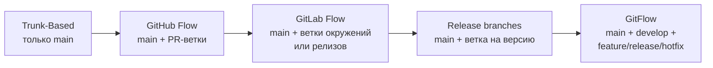

Слева направо растёт число долгоживущих веток и время до интеграции, а
частота релизов, которую стратегия комфортно поддерживает, падает.

| | Trunk-Based | GitHub Flow | GitLab Flow | Release branches | GitFlow |
|---|---|---|---|---|---|
| **Долгоживущие ветки** | `main` | `main` | `main` + `production`/`pre-production` или `X-Y-stable` | `main` + `release/X.Y` | `main` + `develop` |
| **Жизнь рабочей ветки** | Часы, максимум 1–2 дня | Дни | Дни | Дни | Дни–недели |
| **Откуда релиз** | Из `main` (тег) | Из `main` сразу после merge | Из ветки окружения / стабильной ветки | Из `release/X.Y` | Из `release/*` → `main` + тег |
| **Незаконченная работа** | В `main`, но за feature flag | Не мержится, пока не готова | Не мержится, пока не готова | В `main` за флагом, в релиз не попадает | Живёт в `feature/*` и `develop` |
| **Hotfix** | Fix в `main` → деплой (или cherry-pick в релизную ветку) | Обычный PR в `main` | Fix в `main` → cherry-pick вниз по веткам | Fix в `main` → cherry-pick в `release/X.Y` | `hotfix/*` от `main` → merge в `main` и `develop` |
| **Требования к CI** | Очень высокие: `main` обязан быть зелёным всегда | Высокие | Средние–высокие | Средние | Средние |
| **Подходит для** | SaaS, Continuous Deployment, зрелые команды | Веб-сервисы, небольшие и средние команды | Сервисы с явными окружениями или несколькими поддерживаемыми версиями | Продукты, где нужно поддерживать N версий параллельно | Коробочный софт, мобильные приложения, релизы по расписанию |

**Ключевое отличие:** trunk-based и GitHub Flow изолируют незаконченную
работу *в коде* (feature flags, маленькие шаги), а GitFlow изолирует её *в
ветках*. Изоляция в коде требует дисциплины и хорошего CI, зато интеграция
происходит постоянно. Изоляция в ветках снимает часть требований к CI, но
откладывает интеграцию на потом, а чем дольше она откладывается, тем
дороже обходится.

### Что говорит исследование DORA

DORA включает trunk-based development в число технических практик,
которые статистически связаны с более высокой производительностью доставки
(см. [DORA-метрики](../glossary/GLOSSARY.MD) в
[02-cicd-manual](02-cicd-manual.MD#метрики-эффективности)). Критерии,
по которым DORA определяет, что команда действительно работает в trunk-based:

1. Не больше трёх активных веток в репозитории.
2. Ветки вливаются в trunk минимум раз в день.
3. Нет code freeze и отдельных «фаз интеграции».

Даже сам автор GitFlow, Винсент Дриссен, в 2020 году дописал к своей
статье 2010 года «заметку-рефлексию»: для непрерывно доставляемого
веб-софта он советует смотреть в сторону более простых моделей вроде
GitHub Flow, а GitFlow оставить для явно версионируемого ПО, где
параллельно поддерживается несколько версий.

---

## Архитектура: путь изменения от задачи до production

Ниже — путь одного изменения в типичном современном workflow (trunk-based /
GitHub Flow с merge queue). Все остальные стратегии — вариации этой схемы с
дополнительными долгоживущими ветками.

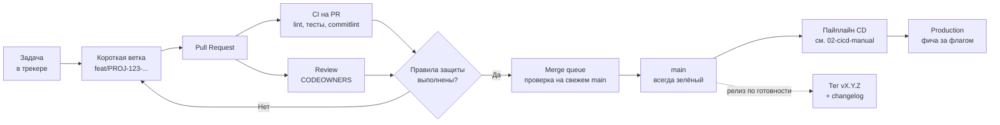

Здесь видно, где проходят границы ответственности:

- **Разработчик** отвечает за размер и содержание ветки и PR.
- **Платформа** (правила защиты веток) не пропустит изменение без
  зелёного CI и нужных одобрений. Это не пожелание, а техническое
  ограничение.
- **CI** проверяет PR, а затем, через merge queue, ещё раз проверяет
  результат слияния с актуальным `main`.
- **CD** забирает каждый коммит в `main` (или каждый тег) и катит артефакт
  по окружениям, как описано в
  [02-cicd-manual](02-cicd-manual.MD#архитектура-cicd-пайплайна).
- **Feature flag** решает, увидят ли пользователи изменение, которое уже
  лежит в production.

### Какие события Git запускают какие пайплайны

Стратегия ветвления на практике — это ещё и карта триггеров CI/CD:

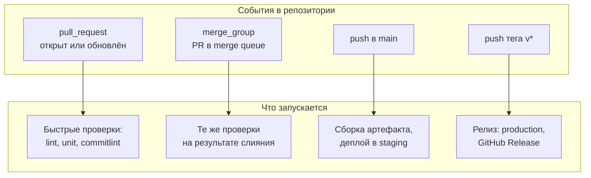

В GitLab роль `merge_group` выполняют pipelines for merge trains, а роль
`pull_request` — merge request pipelines (`$CI_PIPELINE_SOURCE ==
"merge_request_event"`).

---

## Компоненты процесса подробно

### 1. Ветки: основная, рабочие, именование

**Основная ветка** (`main`) — единственная ветка, которая обязана быть в
рабочем состоянии всегда. «Рабочее» значит: собирается, тесты зелёные,
можно выпустить релиз прямо сейчас. Если `main` красный, это инцидент
уровня «все бросают дела», потому что сломанный `main` блокирует всех.

**Рабочие ветки** — короткоживущие ветки под одно изменение. Хорошее
правило: ветка живёт дни, а не недели. В строгом trunk-based — не
дольше 1–2 дней (так рекомендует trunkbaseddevelopment.com). Чем короче
жизнь ветки, тем меньше расхождение с `main` и тем дешевле слияние (механику
этого эффекта см. в [00-git-manual](00-git-manual.MD#паттерн-синхронизируйся-часто)).

**Именование** — не косметика: по префиксу ветки CI может выбирать
поведение, а по номеру задачи трекер автоматически связывает ветку, PR и
тикет. Типичная схема:

```text
<тип>/<ключ-задачи>-<краткое-описание>

feat/PROJ-123-oauth-login
fix/PROJ-456-null-in-invoice-total
chore/bump-node-24
hotfix/PROJ-789-payment-timeout     # только если стратегия предусматривает hotfix-ветки
```

Префиксы удобно совместить с типами Conventional Commits (см. ниже) — одна
система классификации вместо двух.

### 2. Pull Request: размер и описание

PR — единица review и единица интеграции. От его размера зависит почти всё
остальное: качество review, время до merge, вероятность конфликтов, лёгкость
отката.

**Размер.** Классическое исследование code review в Cisco (опубликовано
SmartBear) показало, что эффективность поиска дефектов резко падает, если
за раз смотреть больше 200–400 строк. Руководство Google по code review
тоже настаивает на маленьких изменениях: их быстрее смотрят, внимательнее
проверяют и проще откатывают. Практический ориентир для команды:

| Размер PR (изменённые строки, без сгенерированных файлов) | Что происходит на review |
|---|---|
| до ~200 | Читают внимательно, review за один подход |
| 200–400 | Ещё можно нормально проверить, но уже за время |
| 400+ | Внимание падает, review становится формальным: «LGTM» (Looks Good To Me, «выглядит нормально») не глядя |

Как держать PR маленькими:

- **Разделять рефакторинг и изменение поведения.** Сначала PR «переименовал
  и переложил», потом PR «поменял логику». Смешанный diff невозможно
  отревьюить.
- **Вливать незаконченную фичу за feature flag**, а не копить её в ветке.
- **Stacked PRs** — цепочка зависимых маленьких PR, где каждый следующий
  основан на предыдущем. Их смотрят и вливают по очереди.
- **Отдельные PR для механических изменений** (обновление зависимостей,
  автоформатирование): их проверяют по-другому, и они не должны прятать
  логику.

**Описание PR** должно отвечать на три вопроса: *что* изменилось, *зачем*
(ссылка на задачу, контекст) и *как проверить*. Шаблон
`.github/pull_request_template.md` (в GitLab —
`.gitlab/merge_request_templates/*.md`) превращает это в привычку:

```markdown
## Что и зачем
<!-- Суть изменения и ссылка на задачу: PROJ-123 -->

## Как проверить
<!-- Шаги, команды, скриншоты — всё, что поможет ревьюеру -->

## Чек-лист
- [ ] Изменение за feature flag (если это незаконченная фича)
- [ ] Миграции БД обратно совместимы
- [ ] Документация / runbook обновлены
```

**Draft PR** (черновик) — PR, который открыт для обсуждения и прогона CI, но
явно не готов к merge. Открывайте draft рано: ранний фидбек по подходу дешевле,
чем переписывание готового кода.

### 3. Code review: ревьюеры, одобрения и CODEOWNERS

Цель review — не «найти опечатки» (это работа линтера), а проверить
решение, понять риски и распространить знание о коде в команде. Отсюда
правила:

- **Всё, что можно автоматизировать, делает CI**: форматирование, стиль,
  типы, простые баги, секреты. Человек смотрит на логику, архитектуру,
  безопасность и понятность.
- **Количество обязательных одобрений** — обычно 1, для критичных путей 2.
  Больше двух обычно только растягивает очередь и размывает
  ответственность: каждый думает, что внимательно смотрел кто-то другой.
- **Скорость ответа важнее идеальности.** Первая реакция на PR в течение
  рабочего дня — разумная командная норма; PR, ждущий review три дня,
  неизбежно устаревает и обрастает конфликтами.

**CODEOWNERS** — файл, сопоставляющий пути в репозитории с ответственными
людьми или командами. Когда PR затрагивает эти пути, платформа
автоматически назначает владельцев ревьюерами, а при включённом правиле
«Require review from Code Owners» (GitHub) или соответствующей настройке
защищённой ветки (GitLab) без их одобрения merge невозможен.

Важные детали поведения на GitHub:

- Файл ищется в `.github/`, затем в корне репозитория, затем в `docs/`;
  используется первый найденный.
- Внутри файла **побеждает последнее совпавшее правило**, поэтому общие
  шаблоны пишут вверху, а специфичные ниже.
- Владельцы должны иметь права записи в репозиторий, иначе правило
  молча не работает.

В GitLab CODEOWNERS поддерживает разделы: `[Раздел]` — обязательный раздел,
`^[Раздел]` — опциональный. Обязательное одобрение Code Owners и approval
rules в GitLab доступны на платных тарифах (Premium и выше).

Пример файла — в разделе [практических
примеров](#пример-1-codeowners-для-сервиса-с-инфраструктурой).

### 4. Защита веток и обязательные проверки

Всё описанное выше — договорённости. Защита веток превращает их в
техническое правило, которое нельзя обойти «один раз, очень срочно».

На GitHub есть два механизма: классические **branch protection rules** и
более новые **repository rulesets**. Rulesets можно применять к нескольким
веткам и тегам по шаблону, задавать на уровне организации и описывать
JSON'ом (а значит, хранить как код). Оба механизма могут действовать
одновременно, и тогда применяется **самый строгий вариант** каждого правила.

Минимальный набор правил для `main` (названия опций — как в интерфейсе
GitHub):

| Правило | Зачем |
|---|---|
| Require a pull request before merging | Запрещает прямой push: всё идёт через review и CI |
| Require approvals (1–2) | Хотя бы один человек кроме автора видел изменение |
| Dismiss stale pull request approvals when new commits are pushed | Одобрение относится к конкретному коду; после новых коммитов его надо получить заново |
| Require approval of the most recent reviewable push | Автор последнего push не может сам «одобрить» свои последние изменения чужим старым approve |
| Require review from Code Owners | Изменения в критичных путях видят те, кто за них отвечает |
| Require status checks to pass before merging | Красный CI блокирует merge |
| Require conversation resolution before merging | Замечания review не теряются в свёрнутых комментариях |
| Require linear history | Запрещает merge-коммиты в ветке, остаются squash и rebase |
| Запрет force push и удаления ветки | История `main` не переписывается, ветку не удалить случайно (в классической защите force push запрещён по умолчанию, разрешается опцией «Allow force pushes») |

В GitLab аналог — **Protected branches** (кто может push/merge) плюс
настройки merge request: «Pipelines must succeed», approval rules и
обязательные одобрения Code Owners.

**Обязательные проверки (required status checks)** — названия job'ов CI,
которые должны быть зелёными. Тонкость: чтобы правило работало, job
должен реально запускаться на каждом PR. Если workflow с этим job'ом отфильтрован по путям
(`on.pull_request.paths`) и не запустился, GitHub будет вечно ждать его статуса, и PR
застрянет. Решение — фильтровать по путям шаги внутри job'а, а не сам
запуск, или завести один «итоговый» job, который зависит от остальных
(`needs:`) и всегда отчитывается.

#### Проблема «зелёный PR + зелёный PR = красный main»

Два PR по отдельности проходят CI, но каждый проверялся на *старом*
`main`. После слияния обоих результат может не собраться: например,
один PR переименовал функцию, а второй добавил её новый вызов по старому
имени. Два способа защиты:

- **«Require branches to be up to date before merging»** — перед merge PR
  обязан содержать актуальный `main`. Работает, но не масштабируется: при
  десятке PR в день каждый merge заставляет все остальные обновляться и
  перезапускать CI, и разработчики бесконечно жмут «Update branch».
- **Merge queue** (GitHub) / **merge trains** (GitLab Premium). Одобренные PR
  встают в очередь, платформа сама создаёт временную ветку «`main` +
  этот PR + PR впереди в очереди», прогоняет на ней CI и вливает, только
  если результат зелёный. На GitHub это отдельное событие workflow
  `merge_group`, и обязательные проверки должны запускаться и на нём,
  иначе очередь не продвинется. Merge queue доступна в публичных
  репозиториях организаций и в приватных репозиториях на GitHub Enterprise
  Cloud.

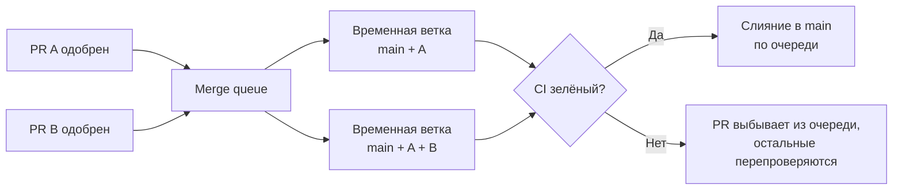

### 5. Метод слияния PR: merge commit, squash или rebase

Техническая механика трёх методов разобрана в
[00-git-manual](00-git-manual.MD#стратегии-интеграции-изменений). Здесь
вопрос другой: какой из них сделать **командным правилом** и как это
настроить.

| Метод | GitHub | GitLab | Что в `main` | Когда выбирать |
|---|---|---|---|---|
| Merge commit | «Merge pull request» (в настройках — Allow merge commits) | Merge commit | Все коммиты ветки + merge-коммит | Ветки, над которыми работали несколько человек и чья внутренняя история ценна; вливание `release/*` обратно в `main` |
| Squash | «Squash and merge» | Опция «Squash commits when merging» при любом методе | Один коммит на PR | Дефолт для большинства команд: «один PR = один коммит = одна запись в changelog», черновой шум ветки не попадает в историю |
| Rebase | «Rebase and merge» | Fast-forward merge (ветку надо предварительно перебазировать) | Коммиты ветки поштучно, линейно, без merge-коммита | Команды, которые приучены делать атомарные коммиты с хорошими сообщениями и хотят сохранить их в `main` |

GitLab дополнительно предлагает «Merge commit with semi-linear history»:
merge-коммит создаётся, но только если ветка перебазирована на актуальную
цель. Получается история, которая читается линейно, но с явными
границами MR.

Практическая рекомендация для команды, которая только выбирает: **squash
merge + заголовок PR в формате Conventional Commits**. Тогда:

- заголовок PR становится сообщением коммита в `main`, и его можно
  проверять линтером в CI (см. [пример
  3](#пример-3-проверки-на-pr-и-в-merge-queue-github-actions));
- `git revert` одного коммита откатывает целый PR;
- инструменты релиза считают версию и changelog по одному коммиту на PR.

Выбранный метод стоит закрепить в настройках репозитория, отключив
остальные. Если оставить все три кнопки, в истории неизбежно окажется
смесь стилей, и автоматика релизов начнёт ошибаться.

### 6. Соглашения о коммитах, версии, теги и changelog

#### Conventional Commits

[Conventional Commits](../glossary/GLOSSARY.MD) (спецификация 1.0.0) —
формат сообщения `type(scope)!: описание`. Для workflow важно, что формат
машиночитаем, поэтому версию можно вычислить автоматически:

| Коммит | Что означает | Влияние на версию (SemVer) |
|---|---|---|
| `fix(api): handle empty invoice list` | Исправление бага | PATCH: 1.4.2 → 1.4.3 |
| `feat(auth): add OAuth login` | Новая функциональность | MINOR: 1.4.2 → 1.5.0 |
| `feat(api)!: drop v1 endpoints` или футер `BREAKING CHANGE: ...` | Несовместимое изменение | MAJOR: 1.4.2 → 2.0.0 |
| `chore:`, `docs:`, `refactor:`, `test:`, `ci:` | Служебные изменения | Обычно не меняют версию |

Ломающее изменение обозначается `!` после типа/scope и/или футером
`BREAKING CHANGE:` (синоним — `BREAKING-CHANGE:`). Типы кроме `feat` и
`fix` спецификация не фиксирует, их набор задаёт соглашение команды
(чаще всего — `@commitlint/config-conventional`).

#### Semantic Versioning

**SemVer 2.0.0** — версия вида `MAJOR.MINOR.PATCH`:

- **MAJOR** — несовместимые изменения публичного API;
- **MINOR** — новая обратно совместимая функциональность;
- **PATCH** — обратно совместимые исправления.

Две детали, о которых часто забывают. Во-первых, для версий `0.y.z` по
спецификации «всё может поменяться в любой момент»: пока не вышла 1.0.0,
стабильного API не обещано. Во-вторых, pre-release обозначается через дефис:
`2.0.0-rc.1` считается *младше* `2.0.0`.

Для внутреннего веб-сервиса без внешних потребителей SemVer не
обязателен: многие команды версионируют такой сервис датой или SHA
коммита. Для библиотек, API, Helm-чартов и всего, чем пользуются другие,
SemVer — фактический стандарт.

#### Теги и changelog

Релиз фиксируется **annotated-тегом** `vX.Y.Z` на коммите в `main` (или
в релизной ветке). Разница annotated и lightweight-тегов и подпись тегов
описаны в [00-git-manual](00-git-manual.MD#ссылки-коммит-head-ветка-тег).
Push тега — стандартный триггер релизного пайплайна.

**Changelog** — человекочитаемый список изменений по версиям. Писать его
руками тяжело, и он неизбежно отстаёт от кода. При Conventional Commits
его генерирует инструмент релиза (release-please, semantic-release,
git-cliff), группируя коммиты по типам. Правило: **тег, changelog и номер
версии создаёт автоматика**, а не человек в конце спринта. Тогда они
никогда не расходятся друг с другом.

### 7. Feature flags: отделить деплой от релиза

[Feature flag](../glossary/GLOSSARY.MD) — ключевой элемент trunk-based
development. Без флагов незаконченная фича должна жить в ветке, и мы
возвращаемся к долгоживущим веткам. С флагами код фичи вливается в `main`
маленькими PR и даже доезжает до production, но остаётся выключенным, пока
его не включат.

Так появляется важное различие:

- **Деплой** — техническое событие: новая версия кода запущена в production.
- **Релиз** — продуктовое событие: пользователи получили новую функциональность.

Флаги бывают разными, и у каждого вида свой срок жизни:

| Тип флага | Назначение | Срок жизни |
|---|---|---|
| Release toggle | Скрыть незаконченную фичу, постепенно включить готовую | Дни–недели, потом удалить |
| Experiment toggle | A/B-тест: разным пользователям разные варианты | Время эксперимента |
| Ops toggle / kill switch | Быстро отключить тяжёлую или рискованную функциональность при инциденте | Может жить долго |
| Permission toggle | Функциональность для отдельных групп (бета-тестеры, внутренние пользователи) | Долго |

Минимальный пример на OpenFeature — вендор-нейтральном стандарте API для
флагов (проект CNCF со статусом incubating). Код обращается к
стандартному API, а поставщика (flagd, Unleash, LaunchDarkly и др.) можно
заменить без переписывания вызовов:

```typescript
import { OpenFeature } from '@openfeature/server-sdk';
import { FlagdProvider } from '@openfeature/flagd-provider';

// поставщик флагов настраивается один раз при старте приложения
await OpenFeature.setProviderAndWait(new FlagdProvider());
const flags = OpenFeature.getClient();

export async function checkout(user: { id: string }) {
  // второй аргумент — значение по умолчанию: если сервис флагов
  // недоступен, фича остаётся ВЫКЛЮЧЕННОЙ, а не падает весь checkout
  const useNewFlow = await flags.getBooleanValue('new-checkout-flow', false, {
    targetingKey: user.id, // для процентного выката одному и тому же пользователю
  });
  return useNewFlow ? newCheckout(user) : legacyCheckout(user);
}
```

Флаги — это технический долг с отсроченным платежом. Каждый release
toggle удваивает число путей выполнения, которые надо тестировать.
Забытые флаги годами висят в коде, и никто не помнит, можно ли их
удалить. Правило: **задача на удаление флага создаётся одновременно с
флагом**, а у флага есть владелец и ожидаемая дата удаления.

Флаги подходят не для всего. Изменение схемы БД или ломающее изменение
API флагом не спрятать; для них нужны паттерны expand/contract («сначала расширить схему или API, перевести код, потом сузить», см.
[раздел про откат в 02-cicd-manual](02-cicd-manual.MD#откат-rollback)) и
**branch by abstraction**. Во втором случае в коде сначала появляется
абстракция над старой реализацией, затем за ней постепенно пишется новая,
и в конце старая удаляется. Каждый шаг при этом отдельный маленький PR в
`main`.

### 8. Конфликты и долгоживущие ветки

Как разрешать отдельный конфликт, объяснено в
[00-git-manual](00-git-manual.MD#пример-4-разрешение-конфликта-от-начала-до-конца).
На уровне команды задача другая: сделать так, чтобы конфликтов было мало
и они были маленькими.

Откуда берутся тяжёлые конфликты:

1. **Долгоживущие ветки.** Расхождение с `main` растёт с каждым днём, а
   сложность слияния растёт быстрее, чем линейно.
2. **Большие механические изменения** (массовое переименование,
   автоформатирование всего проекта), сделанные параллельно с обычной
   работой.
3. **Горячие файлы**: общий конфиг, реестр роутов, файл зависимостей,
   который правят все.

Что с этим делает команда:

- **Ежедневная синхронизация с `main`** (`rebase` своей ветки или `merge`
  `main` в неё — по договорённости) и ежедневная интеграция в `main`.
- **Механические изменения делаются отдельным PR и анонсируются**: «в 14:00
  вливаем форматирование, после этого обновите ветки». Такие коммиты
  стоит добавить в `.git-blame-ignore-revs`, чтобы `git blame` их
  пропускал.
- **Архитектура против горячих файлов**: регистрация через каталоги и
  автообнаружение вместо одного общего списка, в котором правят все.
- **`git rerere`** (`git config --global rerere.enabled true`): Git
  запоминает, как вы разрешили конфликт, и при повторном таком же
  конфликте (например, при нескольких rebase подряд) применяет решение
  сам.

**Если долгоживущая ветка уже есть** (например, крупная миграция), её нужно
регулярно, минимум раз в день, синхронизировать с `main`, а не ждать
финального слияния. Ещё лучше — перестроить работу: вливать в `main` уже
готовые части за флагом или через branch by abstraction, чтобы ветка
укорачивалась, а не росла.

### 9. Hotfix: срочное исправление в production

Hotfix — тот момент, когда workflow проверяется на прочность: всё срочно,
все нервничают, хочется «просто поправить на сервере». Процесс должен быть
заранее описан и отрепетирован, а не придуман во время инцидента.

**Главное правило: исправление должно попасть в основную ветку.** Иначе
следующий обычный релиз вернёт баг обратно: это регрессия, которую команда
сама себе устроила.

Путь hotfix зависит от стратегии:

- **Trunk-based / GitHub Flow, релиз из `main`.** Hotfix — это обычный PR в
  `main` с приоритетным review. Если в `main` уже лежат неготовые к релизу
  изменения, они выключены флагами, и выпустить `main` целиком безопасно.
  Именно поэтому в TBD отдельный hotfix-процесс почти не нужен.
- **Релизные ветки (release branches, GitLab Flow).** Fix делается в
  `main` и затем cherry-pick'ается в поддерживаемую релизную ветку,
  **не наоборот**. Если сделать fix только в релизной ветке, его легко
  забыть перенести в `main`.
- **GitFlow.** Ветка `hotfix/*` от `main`, после исправления она вливается и
  в `main` (с тегом новой PATCH-версии), и в `develop`.

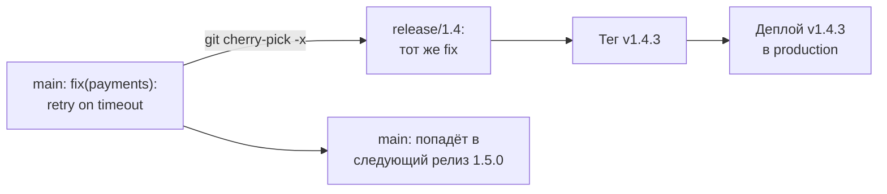

```bash
# fix уже влит в main через обычный PR; переносим его в релизную ветку
git switch release/1.4
git pull --ff-only
# -x дописывает в сообщение "(cherry picked from commit <sha>)" —
# по нему потом видно, откуда пришло изменение
git cherry-pick -x 3f9c2ab
git push origin release/1.4          # лучше тоже через PR, если ветка защищена

git tag -a v1.4.3 -m "fix(payments): retry on timeout"
git push origin v1.4.3               # тег запускает релизный пайплайн
```

Hotfix не отменяет правила защиты веток. Для срочных случаев правильнее
иметь быстрый путь (дежурный ревьюер, приоритетная очередь), чем
выдавать кому-то право обходить защиту: такое право со временем начнут
использовать и для несрочного.

---

## Инструменты

| Категория | Инструменты |
|---|---|
| Git-хостинг и code review | GitHub, GitLab, Bitbucket, Gitea / Forgejo, Gerrit |
| Защита веток | GitHub rulesets и branch protection rules, GitLab protected branches и approval rules |
| Очереди слияния | GitHub merge queue, GitLab merge trains, Mergify |
| Stacked PRs | Graphite, ghstack, spr |
| Проверка сообщений коммитов | commitlint, commitizen |
| Git-хуки локально | pre-commit, husky, lefthook |
| Автоматизация релизов и changelog | release-please, semantic-release, changesets, git-cliff |
| Feature flags | OpenFeature (стандарт API), flagd, Unleash, Flagsmith, GrowthBook, LaunchDarkly, GitLab Feature Flags |
| Автоматические PR с обновлениями зависимостей | Renovate, Dependabot |
| Аналитика процесса (PR cycle time и т. п.) | GitLab Value Stream Analytics, GitHub Insights, LinearB, Swarmia |

Инструменты из этой таблицы не выбирают сами по себе. Сначала команда
договаривается о процессе (стратегия, метод слияния, формат коммитов),
а потом подбирает инструменты, которые этот процесс автоматизируют и
закрепляют.

---

## Практические примеры конфигураций

### Пример 1: CODEOWNERS для сервиса с инфраструктурой

Файл `.github/CODEOWNERS`:

```text
# Порядок важен: при нескольких совпадениях побеждает ПОСЛЕДНЕЕ правило,
# поэтому общее — сверху, специфичное — снизу.

# Владелец по умолчанию для всего репозитория
*                           @acme/backend

# Инфраструктура и пайплайны — только с одобрения платформенной команды
/.github/workflows/         @acme/platform
/deploy/                    @acme/platform
/terraform/                 @acme/platform
Dockerfile                  @acme/platform

# Платёжный модуль — владельцы домена плюс безопасность
/src/payments/              @acme/payments @acme/security

# Сам CODEOWNERS тоже защищаем: иначе любой может вписать себя владельцем
/.github/CODEOWNERS         @acme/platform
```

Три вещи, на которых обычно ошибаются:

1. Команды (`@acme/platform`) должны иметь **права записи** в репозиторий,
   иначе строка не действует.
2. Файл сам по себе только **назначает** ревьюеров. Чтобы их одобрение
   стало обязательным, нужно правило «Require review from Code Owners» (см.
   пример 2).
3. Последняя строка — защита от эскалации: без неё CODEOWNERS можно
   поменять в том же PR, который он должен контролировать.

Для GitLab та же идея с разделами (`CODEOWNERS` в корне, в `docs/` или в
`.gitlab/`; используется первый найденный в этом порядке):

```text
[Platform][1] @acme/platform
/deploy/
/terraform/
.gitlab-ci.yml

^[Docs] @acme/tech-writers
/docs/
```

`[Platform][1]` — обязательный раздел, требующий одного одобрения;
`^[Docs]` — опциональный: владельцев назначат ревьюерами, но merge без них
не заблокируется.

### Пример 2: ruleset для `main` как код (GitHub)

Правила защиты, настроенные мышкой в интерфейсе, не видны на review и не
воспроизводятся на другом репозитории. Ruleset можно хранить в репозитории
платформенной команды как JSON и применять через API:

```json
{
  "name": "main-protection",
  "target": "branch",
  "enforcement": "active",
  "conditions": {
    "ref_name": {
      "include": ["~DEFAULT_BRANCH"],
      "exclude": []
    }
  },
  "rules": [
    { "type": "deletion" },
    { "type": "non_fast_forward" },
    { "type": "required_linear_history" },
    {
      "type": "pull_request",
      "parameters": {
        "required_approving_review_count": 1,
        "dismiss_stale_reviews_on_push": true,
        "require_code_owner_review": true,
        "require_last_push_approval": true,
        "required_review_thread_resolution": true,
        "allowed_merge_methods": ["squash"]
      }
    },
    {
      "type": "required_status_checks",
      "parameters": {
        "strict_required_status_checks_policy": false,
        "required_status_checks": [
          { "context": "test" },
          { "context": "pr-title" }
        ]
      }
    }
  ]
}
```

```bash
# применить к репозиторию (нужны права администратора репозитория)
gh api --method POST repos/acme/checkout-service/rulesets --input main-protection.json

# посмотреть действующие правила
gh api repos/acme/checkout-service/rulesets
```

Что здесь происходит:

- `~DEFAULT_BRANCH` — правило следует за веткой по умолчанию, даже если её
  переименуют.
- `non_fast_forward` запрещает force push, `deletion` — удаление ветки.
- `required_linear_history` вместе с `allowed_merge_methods: ["squash"]`
  закрепляют метод слияния из раздела 5.
- `strict_required_status_checks_policy: false` — это «Require branches to
  be up to date» в выключенном виде. Актуальность относительно `main`
  проверяет merge queue (её включают отдельным правилом `merge_queue`, если
  она доступна на вашем тарифе).
- Имена в `required_status_checks` должны точно совпадать с именами
  job'ов из примера 3.

### Пример 3: проверки на PR и в merge queue (GitHub Actions)

```yaml
name: PR checks

on:
  pull_request:
    branches: [main]
    types: [opened, edited, synchronize, reopened]   # edited — чтобы перепроверять смену заголовка
  merge_group:                                      # запуск внутри merge queue

permissions:
  contents: read

jobs:
  test:
    runs-on: ubuntu-latest
    steps:
      - uses: actions/checkout@v7        # актуальная major-версия на 2026-09; в проде пиньте по SHA
      - uses: actions/setup-node@v7
        with:
          node-version: '24'
          cache: 'npm'
      - run: npm ci
      - run: npm run lint
      - run: npm test

  pr-title:
    # при squash merge заголовок PR становится сообщением коммита в main,
    # поэтому проверяем именно его. В merge queue заголовка нет — job
    # пропускается, а пропущенный job засчитывается как успешный.
    if: github.event_name == 'pull_request'
    runs-on: ubuntu-latest
    steps:
      - uses: actions/checkout@v7
      - uses: actions/setup-node@v7
        with:
          node-version: '24'
          cache: 'npm'
      - run: npm ci
      - name: Lint PR title (Conventional Commits)
        env:
          # заголовок PR — пользовательский ввод: передаём через env,
          # а не подставляем ${{ }} прямо в run (иначе возможна инъекция команд)
          PR_TITLE: ${{ github.event.pull_request.title }}
        run: echo "$PR_TITLE" | npx commitlint --verbose

  pr-size:
    # мягкое предупреждение, а не блокировка: иногда большой PR оправдан
    if: github.event_name == 'pull_request'
    runs-on: ubuntu-latest
    steps:
      - name: Warn on large PR
        env:
          ADDITIONS: ${{ github.event.pull_request.additions }}
          DELETIONS: ${{ github.event.pull_request.deletions }}
        run: |
          total=$((ADDITIONS + DELETIONS))
          echo "Changed lines: $total"
          if [ "$total" -gt 400 ]; then
            echo "::warning::PR изменяет $total строк. Подумайте, можно ли разбить его на части."
          fi
```

Конфиг commitlint в корне репозитория (`commitlint.config.mjs`; с расширением `.js` синтаксис `export default` работает только при `"type": "module"` в `package.json`), зависимости
ставятся через `npm install --save-dev @commitlint/cli
@commitlint/config-conventional`:

```javascript
export default {
  extends: ['@commitlint/config-conventional'],
  rules: {
    // заголовки PR бывают длиннее «идеальных» 50 символов — даём запас
    'header-max-length': [2, 'always', 100],
  },
};
```

Ключевые моменты:

- Событие `merge_group` обязательно, если включена merge queue: без него
  обязательная проверка `test` в очереди никогда не отчитается, и PR
  зависнет.
- `pr-size` не входит в required checks и только предупреждает. Жёсткий
  лимит на размер обычно приводит к тому, что PR режут искусственно.
- Тот же commitlint стоит повесить и на локальный хук `commit-msg`
  (husky, lefthook, pre-commit): ошибку дешевле поймать до push.

### Пример 4: автоматический релиз из Conventional Commits (release-please)

```yaml
name: Release

on:
  push:
    branches: [main]

permissions:
  contents: write        # создавать теги и GitHub Release
  pull-requests: write   # открывать и обновлять релизный PR
  issues: write          # создавать и менять метки релизного PR (как в официальном README)

jobs:
  release-please:
    runs-on: ubuntu-latest
    steps:
      - uses: googleapis/release-please-action@v5   # актуальная major-версия на 2026-09; в проде пиньте по SHA
        with:
          release-type: node    # берёт версию из package.json и обновляет её
```

Как это работает:

1. После каждого push в `main` release-please читает коммиты с последнего
   релиза и открывает (или обновляет) **релизный PR**: в нём новая версия,
   вычисленная по Conventional Commits, и обновлённый `CHANGELOG.md`.
2. Команда вливает релизный PR, когда хочет выпустить версию. Это и есть
   ручные ворота Continuous Delivery, выраженные через обычный PR.
3. После слияния release-please создаёт тег `vX.Y.Z` и GitHub Release. Тег
   может запускать релизный пайплайн (но см. ловушку с `GITHUB_TOKEN` ниже) — тот же, что описан в
   [02-cicd-manual](02-cicd-manual.MD#пример-1-github-actions), только с
   триггером `on: push: tags: ['v*']`.

Важная ловушка: теги и релизы, созданные с `GITHUB_TOKEN`, **не запускают**
другие workflow (это защита GitHub от бесконечных циклов). Если релизный
пайплайн должен стартовать от тега, созданного release-please, либо
передайте action токен GitHub App или PAT (Personal Access Token; параметр `token`), либо
вызовите деплой в том же workflow по выходному значению
`releases_created`.

---

## Стратегии ветвления подробно

### Trunk-Based Development

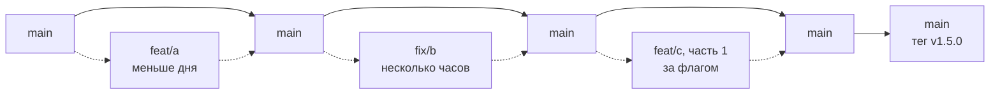

Все интегрируются в `main` минимум раз в день через очень короткие ветки
(в маленьких командах иногда даже прямыми коммитами в trunk). Незаконченная
работа живёт в `main` за feature flags. Релиз — это тег на любом зелёном
коммите `main`, а при Continuous Deployment релизом становится каждый
коммит.

**Требует:** быстрого и надёжного CI (иначе `main` постоянно красный),
feature flags, культуры маленьких PR и быстрых review. **Даёт:** почти
полное отсутствие merge hell, минимальный Lead Time и прямой путь к
Continuous Deployment из
[02-cicd-manual](02-cicd-manual.MD#что-нужно-чтобы-вообще-перейти-к-continuous-deployment).

### GitHub Flow

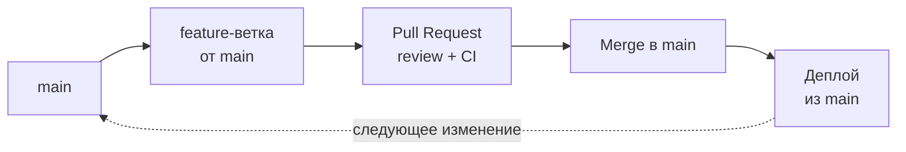

Одно правило: всё, что в `main`, можно деплоить. Любая работа — ветка от
`main` → PR → review и CI → merge → деплой. По сути это trunk-based, где
ветки живут чуть дольше (дни) и незаконченную работу чаще держат в ветке,
а не за флагом. Хороший выбор по умолчанию для веб-сервиса и небольшой
команды.

### GitLab Flow

GitLab Flow добавляет к GitHub Flow долгоживущие ветки там, где это
продиктовано реальностью: деплой происходит не в момент merge, или нужно
поддерживать несколько версий. Существует в двух вариантах.

**С ветками окружений** — изменения «продвигаются» вниз по веткам:

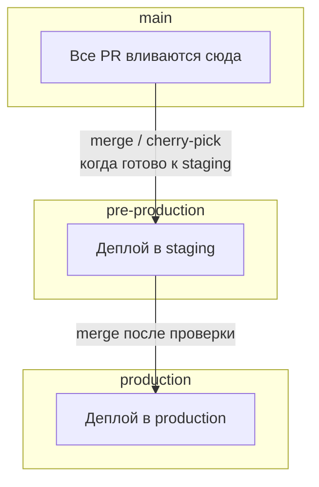

**С релизными ветками** (`2-3-stable`, `2-4-stable`) — для ПО, которое
поставляется версиями. Правило то же, что у release branches ниже:
исправление сначала в `main`, потом cherry-pick в стабильные ветки
(upstream first).

Предостережение про ветки окружений: в мире неизменяемых артефактов из
[02-cicd-manual](02-cicd-manual.MD#best-practices) они часто лишние.
Если по окружениям едет один и тот же образ, «продвижение» удобнее
делать сменой тега образа в конфигурации окружения (или в GitOps-репозитории),
а не слиянием веток кода. Merge из `main` в `production` пересобирает
артефакт из другой ветки, и тогда в production едет не то, что проверили
на staging.

### Release branches (релизные ветки)

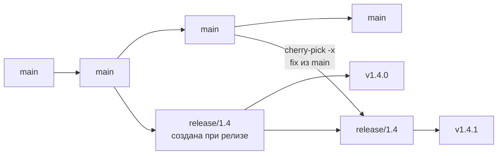

Разработка идёт в `main` по trunk-based. В момент релиза от `main`
создаётся `release/X.Y`, дальше в неё попадают **только исправления,
перенесённые из `main` через cherry-pick**. Новые фичи туда не попадают.
Ветка живёт, пока версия поддерживается.

Подходит, когда пользователи сидят на разных версиях: мобильные
приложения (ревью в сторе занимает дни), коробочный и on-premise софт,
библиотеки с LTS-версиями. Ветка создаётся от `main`, но **никогда не
вливается обратно**. Всё, что в ней есть, уже было в `main`.

### GitFlow

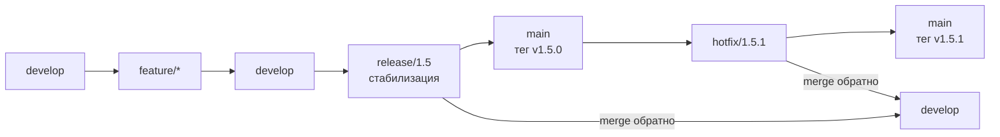

Две долгоживущие ветки: `main` (только релизы, каждый коммит — тег) и
`develop` (интеграция). Фичи — в `feature/*` от `develop`. Перед релизом
создаётся `release/*` для стабилизации, которая вливается и в `main`, и в
`develop`. Срочные исправления идут через `hotfix/*` от `main` и тоже
вливаются в обе ветки.

**Когда оправдан:** явные версии с плановым циклом релизов,
сертификация или QA-фаза перед каждым релизом, поставка клиентам, которые
сами решают, когда обновляться. **Когда вреден:** веб-сервис с частыми
деплоями. Здесь `develop` — лишний слой, из-за которого интеграция
откладывается, а двойные merge (`release` и `hotfix` в две ветки)
регулярно забывают, и исправления теряются.

### Как выбрать

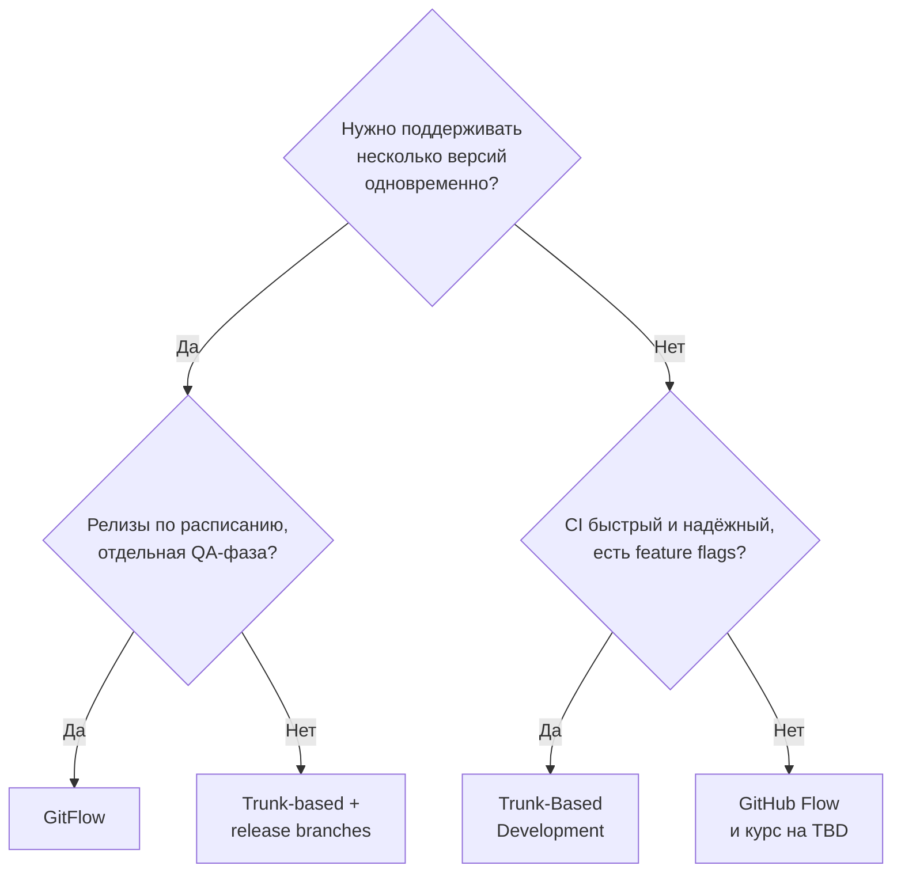

Стратегию можно менять. Обычный путь зрелости выглядит так: GitFlow →
GitHub Flow → trunk-based, по мере того как CI становится быстрее и
надёжнее, а команда осваивает флаги и маленькие PR.

---

## Best Practices

1. **Выбирайте самую простую стратегию, которая покрывает ваши реальные ограничения**: каждая дополнительная долгоживущая ветка — это ещё одна точка отложенной интеграции и ещё одно место, куда можно забыть влить исправление.
2. **Короткие ветки: дни, а не недели** — сложность слияния растёт быстрее, чем линейно, от времени расхождения, а маленькое изменение ещё и дешевле отревьюить и откатить.
3. **Маленькие PR (ориентир — до 200–400 строк)** — внимание ревьюера на большом diff падает, и review превращается в формальность.
4. **Правила — в настройках платформы, а не в wiki** — защиту веток нельзя «забыть» или обойти в спешке, а договорённость на словах нарушается при первом дедлайне.
5. **Защита веток как код (rulesets, Terraform-провайдер GitHub/GitLab)** — правила видны на review, одинаковы во всех репозиториях и восстанавливаются, если кто-то изменил их вручную.
6. **Один метод слияния на репозиторий, остальные отключены** — от этого зависят читаемость истории и корректность автоматического changelog и версий.
7. **Conventional Commits + автоматическая версия и changelog** — релиз перестаёт быть ручной работой, а тег, версия и список изменений не могут разойтись между собой.
8. **Merge queue вместо «Require branches to be up to date» при большом потоке PR** — `main` остаётся зелёным, и разработчикам не приходится бесконечно обновлять ветки.
9. **Feature flags для незаконченной работы, с владельцем и датой удаления** — только так можно интегрироваться ежедневно, не выпуская сырую функциональность, а срок удаления не даёт флагам превратиться в долг.
10. **Hotfix — через `main` (upstream first)** — иначе следующий плановый релиз вернёт исправленный баг.
11. **Автоматизируйте в review всё, что можно** — время человека уходит на логику и риски, а не на отступы и опечатки, которые найдёт линтер.
12. **Ответ на PR в течение рабочего дня** — ожидание review обычно самая большая часть PR cycle time, и именно оно заставляет разработчиков укрупнять PR («раз всё равно ждать»).

---

## Частые ошибки и антипаттерны

| Антипаттерн | Проблема | Решение |
|---|---|---|
| GitFlow «потому что так принято» в веб-сервисе с ежедневными деплоями | Лишний слой `develop`, отложенная интеграция, забытые обратные merge из `release`/`hotfix` | GitHub Flow или trunk-based; GitFlow только для реально версионируемого ПО |
| Долгоживущие feature-ветки «до готовности фичи» | Merge hell, конфликты на дни, интеграционные баги находятся в самом конце | Короткие ветки, незаконченная работа за feature flag, branch by abstraction |
| PR на тысячи строк | Review формальный («LGTM»), баги проходят, откат затрагивает всё сразу | Разбивать: рефакторинг отдельно от поведения, stacked PRs, ориентир 200–400 строк |
| Защита веток не настроена или у админов есть обход «на всякий случай» | Прямые push в `main` в обход CI и review — обычно именно в самый стрессовый момент | Rulesets без исключений; для срочных случаев — быстрый путь review, а не обход |
| Одобрение сохраняется после новых коммитов | Одобрили один код, влили другой | «Dismiss stale approvals» + «Require approval of the most recent reviewable push» |
| Обязательный CI-job с фильтром по путям | Job не запускается, PR навсегда «ждёт» статуса | Фильтровать шаги внутри job'а или завести итоговый job, который всегда отчитывается |
| Разрешены все три метода слияния | Смесь стилей в истории, автоматика релизов считает версии неверно | Один метод на репозиторий, остальные отключить в настройках |
| Hotfix только в релизной ветке или прямо на сервере | Следующий релиз возвращает баг; production расходится с Git | Fix в `main`, затем `cherry-pick -x` в релизную ветку; деплой только из Git |
| Ветки окружений, из которых артефакт пересобирается | В production едет не тот артефакт, который проверили на staging | Один immutable-артефакт; продвижение — сменой версии в конфигурации окружения |
| Флаги, которые никто не удаляет | Комбинаторный взрыв путей выполнения, мёртвый код, никто не помнит, что безопасно выключать | Задача на удаление при создании флага, владелец и срок жизни, регулярный аудит |
| Метрики процесса как KPI отдельных людей | Люди оптимизируют цифру: дробят PR бессмысленно, одобряют не читая | Метрики только на уровне команды и только как повод для ретроспективы |
| Ручной changelog и ручное присвоение версий | Changelog отстаёт, версии не отражают характер изменений, релиз зависит от одного человека | Conventional Commits + release-please / semantic-release |

---

## Метрики эффективности

Результат доставки измеряют [DORA-метрики](../glossary/GLOSSARY.MD) из
[02-cicd-manual](02-cicd-manual.MD#метрики-эффективности), а
Git-workflow определяет их первую часть: сколько времени изменение проводит
между первым коммитом и попаданием в `main`. В [00-git-manual](00-git-manual.MD#метрики-эффективности)
уже есть метрики гигиены репозитория (размер коммита, время жизни ветки).
Здесь — метрики самого командного процесса.

### PR cycle time и его составляющие

**PR cycle time** — время от открытия PR (или от первого коммита в ветке)
до его слияния в `main`. Одно число полезно только для тренда. Чтобы
понять, *где* теряется время, его раскладывают на фазы:

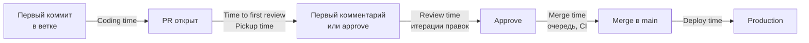

Весь путь от A до F — это Lead Time for Changes из DORA. Отрезок от B до
E — PR cycle time.

| Метрика | Что показывает | Разумный ориентир |
|---|---|---|
| PR cycle time (p50 / p90 — медиана и 90-й перцентиль) | Сколько изменение ждёт от открытия PR до `main` | p50 < 1 дня |
| Time to first review | Как быстро команда реагирует на PR; обычно главный источник ожидания | < 4 рабочих часов |
| Review time | Сколько длятся итерации review; большие значения — признак больших PR или неясных требований | Часы, не дни |
| Размер PR (строк, p50 / p90) | Главный управляемый фактор всех остальных метрик | p50 < 200, p90 < 400 |
| Число раундов review на PR | Сколько раз PR возвращали на доработку; много раундов — повод обсуждать подход раньше (draft PR) | 1–2 |
| Время жизни ветки | Насколько поздно происходит интеграция | < 1–2 дней для trunk-based |
| Число активных веток | Критерий TBD по DORA | ≤ 3 активных веток в репозитории (включая рабочие) |
| Доля PR, влитых без review | Работает ли защита веток на самом деле | 0 |
| Доля выбываний из merge queue | Насколько часто PR «ломают друг друга» или CI нестабилен | Низкая, тренд вниз |
| Возраст самого старого открытого PR | Забытые PR, которые постепенно становятся источником конфликтов | Дни, не недели |

### Как связаны метрики процесса и DORA

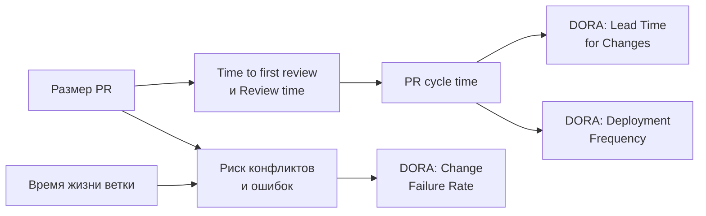

Главный рычаг — **размер PR**. Уменьшение PR ускоряет review, снижает
риск конфликтов и ошибок и в итоге улучшает сразу три из четырёх DORA-метрик.

Предупреждение, без которого эти метрики вредны: **измеряйте команду, а не
людей**. Как только PR cycle time становится личным KPI, работает закон
Гудхарта: цифры улучшаются, процесс нет. Разработчики дробят PR ради
графика, а ревьюеры одобряют не читая. Как и с метриками пайплайна в
02-cicd-manual, смотреть нужно на тренд и обсуждать его на ретроспективе.

---

## Заключение

Git-workflow — это договорённость команды о том, как изменения
превращаются в релизы, закреплённая в настройках платформы. Хороший
workflow делает интеграцию ежедневной и скучной, review быстрым и
осмысленным, а релиз и hotfix — предсказуемыми процедурами. Он напрямую
определяет, насколько быстрым может быть ваш CI/CD: с неделями жизни веток
никакой пайплайн не даст короткий Lead Time.

С чего начать на практике: включите защиту `main` (PR обязателен, 1
approval, зелёный CI, запрет force push), выберите один метод слияния
(для начала — squash) и добавьте проверку заголовка PR по Conventional
Commits. Затем начните измерять размер PR и time to first review, и уже по
этим цифрам решайте, что улучшать дальше: внедрять merge queue,
автоматизировать релизы через release-please или двигаться к
trunk-based с feature flags.

---
