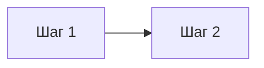

# {Тема}: {Подзаголовок, суть в двух словах}

**Доклад для DevOps-менторства**

---

## Содержание

1. [Введение](#введение)
2. [Что такое {Тема}](#что-такое-тема)
3. [{Ключевые понятия / сравнение вариантов}](#ключевые-понятия)
4. [Архитектура / общая схема](#архитектура)
5. [Этапы / компоненты подробно](#этапы-подробно)
6. [Инструменты](#инструменты)
7. [Практические примеры конфигураций](#практические-примеры-конфигураций)
8. [Стратегии / паттерны применения](#стратегии)
9. [Best practices](#best-practices)
10. [Частые ошибки и антипаттерны](#частые-ошибки-и-антипаттерны)
11. [Метрики эффективности](#метрики-эффективности)
12. [Заключение](#заключение)

---

## Введение

<!--
2-4 абзаца: почему тема важна, что не так "без неё" (проблемы) и что даёт
"с ней" (выгоды). Ориентируйтесь на 02-cicd-manual.MD — блоки "Без CI/CD" /
"С CI/CD" как формат для быстрого контраста.
-->

---

## Что такое {Тема}

<!--
Чёткое определение. Если есть аббревиатура или несколько похожих понятий —
таблица "Аббревиатура | Расшифровка | Суть".
-->

---

## {Ключевые понятия}

<!--
Если в теме есть развилки/варианты (как CI vs CD vs Continuous Deployment) —
сравните их: ASCII- или mermaid-схема + абзац "Ключевое отличие: ...".
-->

---

## Архитектура

<!--
Общая mermaid flowchart, показывающая тему целиком "на одном экране".
Плюс при необходимости — вторая диаграмма для смежного среза (например,
окружений, компонентов системы). См. skill `mermaid-diagrams` за стилем.
-->



---

## Этапы подробно

<!--
Раздел на каждый этап/компонент (### 1. ..., ### 2. ...). Где уместно —
своя мини-диаграмма или список инструментов на этом шаге.
-->

### 1. {Этап}

---

## Инструменты

<!--
Таблица: Категория | Инструменты. Группируйте по смысловым категориям,
как в 02-cicd-manual.MD (платформы, оркестрация, IaC, мониторинг, секреты).
-->

| Категория | Инструменты |
|---|---|
| | |

---

## Практические примеры конфигураций

<!--
2-3 реальных, минимально достаточных конфига (YAML/Dockerfile/скрипт) —
не выдуманные абстракции, а то, что можно скопировать и адаптировать.
-->

### Пример 1: {название}

```yaml
```

---

## Стратегии

<!--
Если у темы есть несколько практических подходов/паттернов (как
Rolling / Blue-Green / Canary в CI/CD) — по одной mermaid-диаграмме и
абзацу объяснения на каждый.
-->

---

## Best Practices

<!--
Нумерованный список, 8-10 пунктов. Каждый пункт — жирным название,
дальше через тире короткое обоснование "почему".
-->

1. **{Практика}** — {почему это важно}.

---

## Частые ошибки и антипаттерны

<!--
Таблица: Антипаттерн | Проблема | Решение.
-->

| Антипаттерн | Проблема | Решение |
|---|---|---|
| | | |

---

## Метрики эффективности

<!--
Если для темы есть общепринятые метрики зрелости (как DORA для CI/CD) —
опишите их и по возможности добавьте mermaid-схему, как они связаны.
-->

---

## Заключение

<!--
3-5 предложений: что тема даёт команде, и практический совет "с чего
начать" — по аналогии с финалом 02-cicd-manual.MD.
-->

---
